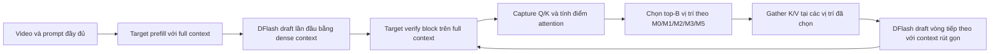

# Báo cáo thực nghiệm: chọn context từ attention của target cho Visual DFlash

**Ngày tổng hợp:** 21/10/2026
**Câu hỏi:** Attention thu được khi target verify một block có thể chọn KV context cho drafter DFlash, giúp tăng acceptance length và tốc độ đầu-cuối hay không?

## Tóm tắt

Đã chạy hai lượt trên Video Detailed Caption (VDC): một lượt sàng lọc 50 mô tả với 8 frame/video, và một sweep trên 20 video dài với 88 frame/video, tại budget 512, 1.024 và 2.048 token. Tuy nhiên sweep thứ hai chỉ có **2.243–2.683 token tổng**; đó là screen khoảng 2,5K, không phải phép thử ở 13K/25K như các thí nghiệm VDC trước đó. Lý do là run này dùng pixel cap thấp; xem phần [đối chiếu các mốc context](#vì-sao-sweep-này-chỉ-25k-trong-khi-các-run-trước-đã-đạt-13k25k).

Đã thử mở lượt high-context bằng sample VDC có calibration 13K, nhưng preflight OOM ở vision attention trước khi target greedy hoặc bất kỳ nhánh DFlash nào hoàn tất. Context 25K chưa được chạy. Vì vậy hiện chưa có số liệu acceptance hoặc speedup ở 13K/25K; chi tiết và bộ nhớ GPU được ghi ở [artifact preflight](../../results/infer/verify_attention_context/high_vdc_preflight_20261021.json).

**Kết quả hiện tại chưa cho thấy method nào đồng thời tăng acceptance và E2E speedup đáng tin cậy.** Tại B=512, M2 có paired speedup point estimate 1,0115× với CI danh nghĩa 95% [1,0036, 1,0199], nhưng acceptance giảm 0,046 token hiệu dụng/vòng [−0,086, −0,006]. Ở B=1.024 và 2.048, không method nào có CI speedup nằm hoàn toàn trên 1. Vì vậy chưa có bằng chứng rằng context selection cải thiện tổng thể Visual DFlash theo tiêu chí đã đặt.

### Đọc nhanh trong 30 giây

| Lượt | Câu hỏi | Kết quả nổi bật | Kết luận nhanh |
|:---|:---|:---|:---|
| **Thí nghiệm 1** · 50 video, 8 frame, B=128 | Các M có tín hiệu tốt trên context vừa phải không? | M0: Δτ=+0,027; speedup=1,002×. Cả hai CI đều chứa mức không đổi. | Chưa thấy cải thiện rõ; đây không phải stress test B≥512. |
| **Thí nghiệm 2** · 20 video dài, tổng context ~2,5K, B=512 | Prune mạnh xuống 20,1% KV có tăng tốc mà vẫn giữ acceptance không? | M2: speedup=1,0115×, nhưng Δτ=−0,046 token/vòng. | Có trade-off ở context ~2,5K; chưa trả lời 13K/25K. |
| **Thí nghiệm 2** · B=1.024/2.048 | Có budget nào giữ acceptance và tăng E2E ổn định không? | Không CI speedup nào nằm hoàn toàn trên 1; M0/B=2.048 còn chậm hơn dense trong screen này. | Chưa có bằng chứng speedup ổn định. |
| **Preflight high-context** · calibration 13K | Có chạy được pilot 13K/25K ngay trên GPU hiện có không? | 13K OOM tại vision SDPA trước decode; 25K chưa chạy. | Chưa có kết quả high-context; cần đủ bộ nhớ GPU cho cả target, drafter và vision attention. |

### Luồng xử lý trong một vòng

**Cách đọc biểu đồ:** điểm là trung bình ghép cặp; thanh là CI bootstrap 95%. Đường ngang nét đứt biểu thị không đổi: Δ acceptance = 0 hoặc speedup = 1×. Ở biểu đồ sweep context ~2,5K, hàng trên là acceptance, hàng dưới là E2E speedup; mỗi cột là một budget.

## Thiết kế và triển khai

### Mô hình và dữ liệu

- **Target:** Qwen2.5-VL-3B-Instruct; BF16, SDPA.
- **Drafter:** SpecForge DFlash depth 3, checkpoint `qwen25vl-3b-dflash-llava68k-h32-depth3-latest` (global step 6375), theo config [`qwen2.5-vl-3b-dflash-h32-depth3.json`](../../src/train_Dflash_SpecForge/configs/qwen2.5-vl-3b-dflash-h32-depth3.json).
- **Dữ liệu:** các dòng `description` trong manifest VDC local `test_100.jsonl`.
- **Giới hạn sinh:** tối đa 64 token mỗi mẫu.
- **Khởi động:** lần draft đầu tiên dùng context dense vì chưa có attention từ verify trước; context đã chọn được áp dụng từ vòng draft tiếp theo.
- **Thời gian E2E:** tính target prefill, draft, verify và selector; không tính load model hay decode/tiền xử lý video dùng chung.

### Các phép chọn attention

Cài đặt tính attention causal trung bình theo head từ query/key sau RoPE của target; chỉ chấm miền key hợp lệ cho phần query được xác minh. Sau đó lấy top-k token theo điểm và trả các chỉ số về thứ tự gốc để gather K/V cho drafter. Target vẫn verify với context đầy đủ.

| Method (tên trong Phase A) | Điểm dùng để xếp hạng token context |
|:---|:---|
| M0 — FastKV / single-query | Query cuối ở layer 18 |
| M1 — DFlash-MQ | Giá trị lớn nhất qua các query của accepted prefix ở layer 18 |
| M2 — SnapKV / avg-pool k=7 | Average pooling kernel 7 trên điểm của query cuối ở layer 18 |
| M3 — RocketKV / max-pool k=7 | Max pooling kernel 7 trên điểm của query cuối ở layer 18 |
| M5 — Deep Sink / pure L35 | Query cuối ở layer 35 |

Các biến thể M được lấy từ danh sách trong [PHASE_A_MASTER.md](../PHASE_A_MASTER.md), rồi triển khai và đánh giá riêng cho Visual DFlash/VDC trong nghiên cứu này; không bê nguyên benchmark hay kết luận của tài liệu đó. Do SDPA không cung cấp trực tiếp toàn bộ attention matrix, runner tái dựng causal attention từ Q/K đã capture trong verify. Chi tiết có thể kiểm tra tại [selector implementation](../../src/infer/verify_attention_selectors.py) và [inference runner](../../src/infer/qwen25vl_verify_attention_context.py).

## Thí nghiệm 1 — Sàng lọc trên 50 mẫu, 8 frame, B=128

### Mục tiêu và cách chạy

Lượt đầu dùng các mẫu description có index 0–49, mỗi video lấy 8 frame. Prompt dài 243–283 token, trung bình 269,72. Có 6 nhánh (dense và năm selector), tổng cộng 300 lượt DFlash; mỗi nhánh sinh tối đa 64 token. B=128 cắt context, nhưng quy mô này không kiểm tra được hành vi ở budget 512 trở lên.

### Kết quả chính

| Method | τ_effective dense → method | Δ τ_effective / vòng (95% CI) | E2E speedup ghép cặp (95% CI) | Context giữ lại | Scoring + top-k |
|:---|---:|---:|---:|---:|---:|
| M0 | 2.426 → 2.453 | +0.027 [−0.015, +0.072] | 1.002× [0.986, 1.018] | 42,8% | 7,62 ms/decode |
| M1 | 2.426 → 2.438 | +0.012 [−0.031, +0.058] | 0.994× [0.978, 1.011] | 42,8% | 7,97 ms/decode |
| M2 | 2.426 → 2.404 | −0.022 [−0.065, +0.020] | 0.982× [0.967, 0.998] | 42,8% | 8,26 ms/decode |
| M3 | 2.426 → 2.401 | −0.025 [−0.059, +0.010] | 0.983× [0.970, 0.995] | 42,8% | 8,33 ms/decode |
| M5 | 2.426 → 2.408 | −0.018 [−0.044, +0.008] | 0.986× [0.974, 0.997] | 42,8% | 8,18 ms/decode |

CI được bootstrap ghép cặp theo mẫu, 30.000 lần. M0 có point estimate acceptance cao hơn dense nhưng CI còn chứa 0; speedup cũng không tách khỏi 1. M2/M3/M5 chậm hơn trong screen này. Tất cả selector cho output giống dense DFlash trên 50/50 mẫu; dense và selector khớp target greedy autoregressive trên 24/50 mẫu.

**Diễn giải dễ hiểu:** ở B=128, M0 có vẻ nhận thêm khoảng 0,027 token/vòng, nhưng sai số còn tương thích với không thay đổi; tốc độ cũng xấp xỉ dense. Không có dấu hiệu method thắng ổn định.

Lý do cần lượt dài hơn: một pilot 8-frame ở B=512 có prompt ngắn hơn budget nên không loại context nào. Vì vậy không thể dùng pilot đó để kết luận về khả năng chọn context dài.

**Artifact:** [JSON lượt 50 mẫu](../../results/infer/verify_attention_context/qwen25vl3b_vdc_descriptions_all50_b128.json), [báo cáo lượt 1](../../results/infer/verify_attention_context/REPORT.md).

## Thí nghiệm 2 — Sweep budget trên context khoảng 2,5K

### Mục tiêu và cách chạy

Chọn 20 mẫu description dài nhất trong cohort local, index 30–49; thời lượng video 128,967–238,074 giây. Mỗi video lấy cố định 88 frame, 50.176 pixel/frame. Prompt dài 2.243–2.683 token tổng, trung bình 2.524,6; cả 20 prompt dài hơn budget lớn nhất 2.048. So sánh dense với M0/M1/M2/M3/M5 ở ba budget. Mỗi mẫu/nhánh chỉ có một lượt timing.

### Vì sao sweep này chỉ ~2,5K trong khi các run trước đã đạt 13K/25K?

Đây là khác biệt cấu hình của **thí nghiệm mới**, không phải giới hạn của VDC:

- Runner context-selection nhận `video_min_pixels=video_max_pixels=50.176` mặc định. Với 88 frame, Qwen processor tạo sequence tổng 2.243–2.683 token. Tôi đã tăng số frame nhưng không dùng lại cấu hình pixel/calibration độ phân giải cao từ các run trước.
- Các run trước đặt mốc theo **số visual token** (`target_visual_tokens`) rồi hiệu chỉnh số frame và pixel/frame. Ví dụ trong calibration VDC, sample `v_SEVVSei-r6w` đạt 12.096 visual token với 96 frame ở 200.704 pixel/frame, và 24.192 visual token với 192 frame ở cùng mức pixel. Các mốc này là visual-only; context tổng còn có text và token điều khiển video.
- Run trước cũng dùng đường model-parallel hai GPU và checkpoint DFlash khác; lượt context-selection này dùng checkpoint depth-3 mới và chạy `cuda:0` với SDPA. Pilot tăng frame trong cấu hình mới gặp OOM, nên screen đã dừng ở độ phân giải thấp thay vì ghép ngay với hạ tầng run cũ.
- Do đó kết quả hiện tại chỉ mô tả selector ở context tổng khoảng 2,5K. Không nên dùng nó làm kết luận cho các context 13K/25K.

Run VDC trước đã đo các mốc 13K/25K visual token, nhưng được báo cáo là **INCOMPLETE DIAGNOSTIC**: ở length sweep 13K có 5/50 output exact-match; ở 25K có 9/49, cùng 1 row unsupported. Đây là tiền lệ cho phép xử lý context lớn, không phải bằng chứng rằng selector M hoạt động tốt ở độ dài đó. Xem [báo cáo DFlash trước](../../results/DFlash_Qwen2.5VL3B_report/REPORT_FINAL.md), [bảng length sweep](../../results/DFlash_Qwen2.5VL3B_report/length_summary.csv) và [calibration VDC](../../dataset/VideoDetailCaption/calibration.jsonl).

- Tổng cộng 360 lượt (20 video × 6 nhánh × 3 budget); cả 360 hoàn tất.
- 300 output selector khớp dense DFlash (20 mẫu × 5 selector × 3 budget).
- Baseline dense có τ_effective trung bình 2,155 ở cả ba budget.
- Latency E2E dense trung bình lần lượt là 4,175 s, 4,286 s và 4,331 s ở B=512/1.024/2.048. Các so sánh speedup bên dưới là ghép cặp **trong cùng budget**; không diễn giải chênh lệch latency giữa các budget như một so sánh trực tiếp.
- Bootstrap 30.000 lần lấy mẫu theo video, CI 95% chưa hiệu chỉnh cho nhiều phép so sánh.

### Kết quả chính theo budget

| Budget | Method | Δ τ_effective / vòng (95% CI) | E2E speedup ghép cặp (95% CI) | KV giữ lại |
|---:|:---|---:|---:|---:|
| 512 | M0 | −0.065 [−0.104, −0.026] | 0.9960× [0.9830, 1.0086] | 20,1% |
| 512 | M1 | −0.068 [−0.111, −0.022] | 1.0003× [0.9885, 1.0132] | 20,1% |
| 512 | M2 | −0.046 [−0.086, −0.006] | **1.0115× [1.0036, 1.0199]** | 20,1% |
| 512 | M3 | −0.051 [−0.093, −0.008] | 1.0050× [0.9945, 1.0157] | 20,1% |
| 512 | M5 | −0.012 [−0.058, +0.034] | 1.0143× [0.9998, 1.0288] | 20,1% |
| 1.024 | M0 | −0.021 [−0.057, +0.016] | 1.0063× [0.9950, 1.0178] | 40,2% |
| 1.024 | M1 | −0.024 [−0.064, +0.018] | 0.9910× [0.9769, 1.0055] | 40,2% |
| 1.024 | M2 | +0.004 [−0.040, +0.048] | 1.0057× [0.9951, 1.0162] | 40,2% |
| 1.024 | M3 | −0.008 [−0.045, +0.030] | 1.0033× [0.9881, 1.0193] | 40,2% |
| 1.024 | M5 | −0.008 [−0.038, +0.026] | 1.0060× [0.9924, 1.0189] | 40,2% |
| 2.048 | M0 | −0.003 [−0.024, +0.018] | 0.9867× [0.9730, 0.9997] | 80,4% |
| 2.048 | M1 | +0.004 [−0.018, +0.027] | 0.9869× [0.9736, 1.0004] | 80,4% |
| 2.048 | M2 | +0.012 [−0.008, +0.032] | 1.0029× [0.9934, 1.0133] | 80,4% |
| 2.048 | M3 | +0.016 [−0.005, +0.038] | 0.9916× [0.9784, 1.0040] | 80,4% |
| 2.048 | M5 | +0.007 [−0.016, +0.030] | 1.0019× [0.9936, 1.0109] | 80,4% |

`τ_effective = τ_proposal + 1`, tính cả token bonus target xác nhận. Speedup là trung bình ghép cặp theo video của `T_dense / T_method`. Chi phí scoring + top-k trong sweep dài khoảng 0,45–0,52 ms/vòng và đã nằm trong E2E.

### Diễn giải sweep

- **B=512:** M2 là nhánh duy nhất có CI speedup danh nghĩa nằm trên 1, nhưng acceptance giảm 0,046 token/vòng và CI giảm không chứa 0. Đây là trade-off giữa acceptance và thời gian E2E, không đạt tiêu chí kết hợp. M5 có speedup point estimate cao nhất, nhưng CI còn chạm/bao gồm 1 và acceptance point estimate âm.
- **B=1.024:** mọi CI speedup đều bao gồm 1; thay đổi acceptance cũng chưa tách rõ khỏi 0.
- **B=2.048:** không method nào cho speedup đáng tin cậy; M0 có CI speedup nằm dưới 1 trong screen này. Acceptance point estimate của M1/M2/M3/M5 hơi dương nhưng CI đều chứa 0.
- B=2.048 vẫn giữ trung bình 80,4% context; giảm context nhiều nhất là B=512, còn 20,1%.

**Diễn giải dễ hiểu:** B=512 cắt context mạnh nhất. M2 có vẻ chạy nhanh hơn dense, nhưng số token được chấp nhận giảm rõ trong phép đo này. Khi nới budget lên 1.024 hoặc 2.048, acceptance gần dense hơn, nhưng lợi ích tốc độ không còn phân biệt được với nhiễu của screen hiện tại.

**Artifacts:** [summary JSON](../../results/infer/verify_attention_context/long_vdc_budget_sweep_summary.json), [B=512](../../results/infer/verify_attention_context/long_vdc_88f_b512.json), [B=1.024](../../results/infer/verify_attention_context/long_vdc_88f_b1024.json), [B=2.048](../../results/infer/verify_attention_context/long_vdc_88f_b2048.json), [báo cáo lượt dài](../../results/infer/verify_attention_context/REPORT_LONG_CONTEXT.md).

## Thí nghiệm 3 — Preflight context cao 13K/25K (chưa hoàn thành)

### Mục tiêu và cách chạy

Mục tiêu là dùng lại các điểm calibration VDC đã đo, thay vì tăng frame trên pixel cap thấp. Pilot đầu tiên dùng sample `v_SEVVSei-r6w` (manifest index 52), calibration target 13.000 visual token, thực tế 12.096 visual token, 96 frame và `max_pixels=200704`. Kế hoạch sweep giữ các nhánh dense/M0/M1/M2/M3/M5 và budget 512/1.024/2.048, tối đa 64 token sinh mỗi nhánh.

Target Qwen2.5-VL-3B và draft BF16 được nạp trên RTX A4000. Video prompt đã được chuẩn bị và target vision forward bắt đầu, nhưng SDPA cần thêm 4,36 GiB khi còn 4,15 GiB khả dụng; tiến trình đang dùng 11,57 GiB. Lượt dừng trước khi target greedy hoàn tất, do đó chưa có nhánh DFlash nào chạy. Tại cùng thời điểm, RTX 3090 còn 1.334 MiB trống và đang được một workload huấn luyện khác sử dụng, nên không dùng GPU đó.

### Kết quả và giới hạn

- **13K:** preflight thất bại do thiếu bộ nhớ tại vision attention. Calibration xác nhận 12.096 visual token; tổng `input_tokens` (text + visual) không được runner lưu trước lỗi, nên không ghi một con số tổng ước đoán.
- **25K:** chưa chạy. Lượt 13K chưa qua được bước vision forward trên GPU còn trống; không có cơ sở để tuyên bố 25K đã được thử.
- **Acceptance, output parity, answer quality và E2E timing:** không có số liệu vì chưa hoàn thành lần decode nào.
- Đây là lỗi vận hành/bộ nhớ, không phải kết quả ủng hộ hay bác bỏ giả thuyết context selection.

**Artifact:** [preflight JSON](../../results/infer/verify_attention_context/high_vdc_preflight_20261021.json). File runner output được giữ riêng nhưng có `samples=[]`, nên không được dùng như kết quả inference.

**Highest green rung của lượt high-context:** R1 (GPU/model/config visibility). Bước forward thực tế chưa qua R2 do OOM; lượt này chưa đạt R5 pilot.

## Độ đúng và giới hạn diễn giải

- Selector không làm thay đổi output so với dense DFlash trong các mẫu đã chạy. Đây là kiểm tra parity giữa hai đường DFlash, không chứng minh output đúng với target greedy.
- Ở lượt 88-frame, dense DFlash khớp target greedy autoregressive trên 7/20 video. Do đó τ đo ở đây phản ánh acceptance theo verifier block hiện tại; chưa thể diễn giải như acceptance đã xác nhận theo greedy target.
- Mỗi video/nhánh chỉ có một lượt timing. Bootstrap theo video phản ánh biến thiên giữa video, không ước lượng nhiễu timing giữa các lần chạy.
- Cohort là 20 video dài nhất trong local `test_100.jsonl`, không phải toàn bộ dataset VDC. Sinh tối đa 64 token cũng chưa đánh giá đầy đủ câu trả lời dài.
- B=4.096 không chạy vì prompt dài nhất chỉ 2.683 token nên budget đó không cắt context. Pilot 96 frame OOM trên một video nhiều patch (yêu cầu thêm 3,96 GiB khi chỉ còn 3,88 GiB); pilot 192 frame cần 15,82 GiB trong vision SDPA và OOM. Đây là giới hạn bộ nhớ của cấu hình, không phải thất bại của phương pháp chọn context.
- Một lượt 80 frame không dùng trong sweep chính vì hai prompt ngắn hơn B=2.048; lượt chính cố định 88 frame để mọi sample đều vượt budget lớn nhất.

## Kết luận đánh giá

### CONFIRMED

Không method/budget nào đạt đồng thời tiêu chí đã đặt: acceptance point estimate không giảm và CI 95% của paired E2E speedup nằm hoàn toàn trên 1. Vì vậy kết quả hiện tại **không xác nhận** giả thuyết context selection cải thiện đồng thời acceptance length và tốc độ đầu-cuối.

### EXPLORATORY

- M2/B=512 có speedup danh nghĩa 1,0115× [1,0036, 1,0199], nhưng giảm acceptance 0,046 token hiệu dụng/vòng [−0,086, −0,006].
- B=2.048 cho một vài point estimate acceptance dương nhỏ, nhưng CI chứa 0 và không có speedup đáng tin cậy.
- Các selector thực sự giảm số KV đưa vào drafter theo budget và giữ output DFlash bằng dense trong tập đã chạy. Đây là bằng chứng triển khai, chưa phải bằng chứng cải thiện metric mục tiêu.

### FAILED / INCOMPLETE

- Pilot 8-frame/B=512 không tạo context đủ dài để prune; không dùng nó làm kết quả cho budget lớn.
- Các pilot 96/192 frame bị giới hạn bởi OOM vision SDPA. Chưa có phép đo hợp lệ ở B=4.096 trở lên.
- Preflight calibration 13K cũng OOM trên A4000 trước khi decode; 25K chưa chạy. Đây là blocker vận hành, không phải bằng chứng phương pháp thất bại.
- Chưa chạy lặp timing hoặc lặp thứ tự arm; vì vậy chưa xác định độ ổn định run-to-run của speedup.

### HIGHEST VERIFIED RUNG

**R5 — Short pilot / early signal:** paired screen ở context tổng 2,2–2,7K hoàn tất trên 20 video ở ba budget với 360/360 lượt thành công; artifact chính là [summary JSON](../../results/infer/verify_attention_context/long_vdc_budget_sweep_summary.json) và ba file kết quả budget được dẫn ở trên. Đây chưa phải full study có lặp độc lập và chưa kiểm tra context 13K/25K.

### EVIDENCE GAPS

- Block verification chỉ khớp target greedy autoregressive trên 7/20 video ở lượt dài.
- Một lần timing mỗi mẫu/nhánh không đo được độ nhiễu giữa các lần chạy; CI hiện tại chưa hiệu chỉnh cho nhiều phép so sánh.
- Chưa đánh giá selector M ở context 13K/25K visual token như các run VDC trước.
- Preflight 13K không hoàn tất trên GPU khả dụng; context tổng text + visual chưa được ghi và 25K chưa được thử.
- Chưa đánh giá cohort rộng hơn hoặc đầu ra dài hơn.
- Chưa có selector nào chứng minh tăng acceptance mà vẫn tăng E2E speedup.

### RECOMMENDED NEXT

**R6 — high-context replicated paired study:** trước hết đưa selector runner lên đường preprocessing/model-parallel đã dùng cho context 13K/25K, rồi chạy dense và các M ở B=512/1.024/2.048 trên cùng cohort high-context; giữ tối thiểu ba lượt timing theo thứ tự arm ngẫu nhiên. Đồng thời xử lý hoặc cô lập sai khác giữa target block verify và greedy AR. Mục tiêu là kiểm tra trực tiếp giả thuyết ban đầu trong đúng regime 13K/25K.

Trước R6, cần có GPU đôi khả dụng theo model-parallel hoặc một cấu hình vision attention đã xác nhận vừa đủ bộ nhớ; sau đó phải lưu tổng prompt token count trước khi decode để báo riêng visual token và text + visual token.

**Supported:** pipeline chọn top-k KV từ attention target verify chạy được trên context tổng 2,2–2,7K token, hoàn tất đủ ba budget và giữ output của selector bằng dense DFlash trong các mẫu đã đo.

**Not supported:** context selection làm tăng acceptance length một cách đáng tin cậy, tăng E2E speedup, hoặc giữ acceptance tương ứng với greedy autoregressive target.

Verified through **R5 (paired ~2.5K-context pilot)**. The new 13K/25K follow-up reached only R1 and did not pass its R2 forward smoke. Not yet verified by **R6 (replicated 13K/25K-context study)**.
