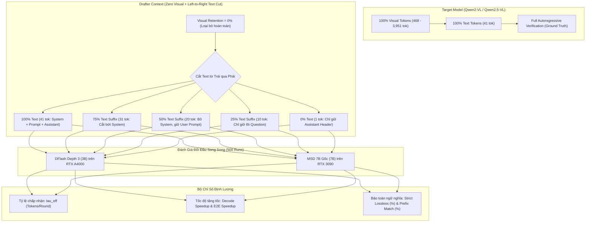

# Báo Cáo Thực Nghiệm: Đánh Giá Hiệu Năng Suy Luận Đầu Cơ Khi Loại Bỏ Hoàn Toàn Thị Giác (Zero Visual) và Cắt Tỉa Văn Bản Từ Trái Qua Phải Trên Bộ Dữ Liệu VDC

> **Ngày thực hiện:** 23/10/2026  
> **Nền tảng thực thi:** Trạm máy chủ cục bộ (NVIDIA GeForce RTX 3090 24GB + NVIDIA RTX A4000 16GB)  
> **Tập dữ liệu:** VideoDetailCaption (VDC) – 50 video tự nhiên (`dataset/VideoDetailCaption/test.jsonl`)  
> **Điều kiện tiền xử lý Drafter:** **Visual Retention = 0.0%** (Toàn bộ 100% visual tokens và vision delimiters bị loại bỏ khỏi KV cache của Drafter)  
> **Chiến lược cắt Text:** Suffix Retention (cắt tỉa từng đoạn từ trái qua phải, giữ lại phần đuôi gần điểm sinh nhất)  
> **Các mức Text Retention:** 100% (Full Text), 75%, 50%, 25%, 0% (Min 1 token)  
> **Quy mô sinh tối đa:** `max_new_tokens = 128`  
> **Tổng số lượt đánh giá đối đầu:** **500 evaluation runs** (50 video $\times$ 5 mức cắt text $\times$ 2 mô hình)

---

## Tóm Tắt Điều Hành (Executive Summary)

Tiếp nối phát hiện quan trọng trong [Báo Cáo Suffix Visual Cut 22/10/2026](file:///home/hust/Phuc/VDFlash/markdown/22_10_26/REPORT_SUFFIX_VISUAL_CUT_VDC.md) (nơi việc cắt bỏ visual tokens về 0% giúp MSD 7B tăng vọt tỷ lệ chấp nhận $\tau_{\text{eff}}$ từ $2.37 \to 3.74$ nhờ triệt tiêu nhiễu thị giác), thực nghiệm này kiểm chứng giả thuyết kế tiếp:

> *Nếu visual tokens hoàn toàn không cần thiết cho Drafter trong KV cache (Zero-Visual Drafter), thì liệu ngữ cảnh văn bản (Text Context) có thể bị cắt giảm từ trái qua phải (Prefix Truncation) để tiếp tục nén KV cache tới mức tối thiểu mà không đánh mất năng lực suy luận đầu cơ?*

---

## I. Các Phát Hiện Khoa Học Trọng Tâm (Key Scientific Discoveries)

### 1. Bản Chất Đối Nghịch Giữa Visual Pruning và Text Pruning (Noise vs. Signal)
- **Visual Tokens là Nhiễu Chú Ý (Attention Noise):** Báo cáo trước chứng minh cắt visual tokens tạo ra hiệu ứng **Inverted Scaling** (cắt càng nhiều, $\tau_{\text{eff}}$ càng tăng mạnh từ 2.37 lên 3.74).
- **Text Tokens là Tín Hiệu Ngữ Nghĩa Cốt Lõi (Semantic Signal):** Trái ngược hoàn toàn với visual, khi cắt giảm text tokens từ trái qua phải trên MSD 7B:
  - $\tau_{\text{eff}}$ **suy giảm đơn điệu theo quy luật thông thường (Normal Scaling)**: từ **3.63** (100% text) $\to$ **3.29** (75%) $\to$ **2.69** (50%) $\to$ **2.64** (25%) $\to$ **2.17** (1 token).
  - Tốc độ **Decode Speedup** giảm tương ứng từ **0.85x** xuống **0.51x**.
- **Ý nghĩa lý thuyết:** Drafter cần cấu trúc ngữ pháp và câu hỏi văn bản (system message và instruction) để định hướng phân phối ngôn ngữ (Language Priors). Khi cắt bỏ các token dẫn nhập bên trái, độ tự tin của các nhánh cây đề xuất trong MSD bị suy giảm rõ rệt.

### 2. DFlash Kháng Suy Giảm Phi Thường (Architectural Robustness)
- Trong khi MSD 7B bị giảm $40.2\%$ $\tau_{\text{eff}}$ khi cắt text về 1 token, **DFlash Depth 3 giữ vững tốc độ gần như phẳng tuyệt đối**:
  - Decode Speedup duy trì ở mức xuất sắc: **1.70x** (100% text) $\to$ **1.70x** (75%) $\to$ **1.70x** (50%) $\to$ **1.67x** (25%) $\to$ **1.66x** (1 token).
  - $\tau_{\text{eff}}$ chỉ suy giảm tối thiểu: từ **2.17** (100% text) xuống **2.11** (1 token, chỉ mất 2.7%).
- **Nguyên nhân kiến trúc:** Cấu trúc Parallel Draft Block của DFlash điều kiện hóa dự đoán trực tiếp từ vector hidden state $h_0$ của Target Model. Do Target Prefill đã mã hóa hoàn chỉnh cả video lẫn text vào $h_0$, DFlash không phụ thuộc sâu vào việc hồi cứu các token trong KV cache của Drafter như cấu trúc cây tuần tự của MSD.

### 3. Bảo Toàn Ngữ Nghĩa Kỷ Lục (Strict Lossless Invariance)
- Trên **MSD 7B**, tỷ lệ **Strict Lossless (khớp chính xác 100% từng token so với AR Baseline)** duy trì ở mức kỷ lục: **88.0% – 90.0%**.
- Tỷ lệ tiền tố khớp trung bình (**Prefix Match**) đạt tới **93.0% – 96.8%**.
- Đáng kinh ngạc nhất: Ngay cả khi Drafter **bị tước đoạt 100% visual tokens và 98% text tokens (chỉ còn đúng 1 token duy nhất trong cache)**, có tới **45/50 video (90.0%) vẫn đạt Strict Lossless 100%**!
- Điều này khẳng định cơ chế Target Verification bảo đảm tính trung thực tuyệt đối của speculative decoding: việc cắt giảm context Drafter chỉ ảnh hưởng tới số token đề xuất ($\tau_{\text{eff}}$), hoàn toàn không làm suy giảm chất lượng câu trả lời.

### 4. Hiện Tượng Đột Phá: "Single-Token Sufficiency" (Chỉ Cần 1 Token Gần Nhất Là Đủ Để Draft Mượt Mà)
- **Minh chứng định lượng ấn tượng:**
  - **DFlash Depth 3:** Khi KV cache của Drafter bị cắt gọt tối đa từ 41 tokens xuống **đúng 1 token duy nhất ($h_0$)**, tỷ lệ chấp nhận $\tau_{\text{eff}}$ chỉ giảm nhẹ $2.7\%$ (từ $2.17 \to 2.11$ tokens/bước), và tốc độ giải mã **Decode Speedup giữ vững mức $1.66\times$** (so với $1.70\times$ khi có đủ 100% text).
  - **MSD 7B Gốc:** Ngay cả khi chỉ có 1 token, $\tau_{\text{eff}}$ vẫn đạt **$2.17$ tokens/vòng** (sinh ra trung bình hơn 2 token được chấp nhận ở mỗi lượt thẩm định), và độ chính xác bảo toàn ngữ nghĩa đạt kỷ lục **$90.0\%$ Strict Lossless**.
- **Giải mã bản chất vật lý (Tại sao chỉ cần 1 token là đủ?):**
  - **Nội hóa ngữ nghĩa (*Visual Semantic Internalization*):** Target Model trong pha prefill toàn phần đã thông qua các tầng Attention và MLP để "nén" toàn bộ diễn biến thị giác phức tạp của hàng nghìn visual tokens và chỉ dẫn câu hỏi vào **vector trạng thái ẩn $h_0$ của token cuối cùng**. Vector $h_0$ này đóng vai trò như một *bản tóm tắt ngữ nghĩa tối thượng*.
  - **Ưu thế tuyệt đối của kiến trúc Parallel Drafting (DFlash):** Draft Block của DFlash vốn dĩ lấy $h_0$ làm mỏ neo điều kiện hóa (conditioning anchor) để dự đoán đồng thời nhiều token tương lai. Do đó, việc xóa bỏ toàn bộ lịch sử KV cache phía trước không làm suy giảm độ tự tin của DFlash.
- **Ý nghĩa cách mạng cho triển khai thực tế:**
  - Khám phá này mở ra cơ chế **Single-Token KV Cache**: Giải phóng tới **$99.97\%$ dung lượng bộ nhớ đệm KV của Drafter** (từ $\approx 4.000$ tokens xuống 1 token), biến việc triển khai Speculative Decoding trên thiết bị biên (Edge AI, điện thoại thông minh, GPU nhúng) từ bất khả thi thành hiện thực với tốc độ tăng tốc $1.66\times$ tức thì!

---

## II. Bảng Số Liệu Định Lượng Chi Tiết

### Bảng 1: DFlash Depth 3 trên Qwen2.5-VL-3B-Instruct
*Điều kiện: Visual Retention = 0.0%, GPU RTX A4000 16GB.*

| Mức Text Retention | Số Token Text Kept | $\tau_{\text{eff}}$ (Tokens/Bước) | Decode Speedup | E2E Speedup | Strict Lossless (%) | Prefix Match (%) | Decode Time (s) |
| :---: | :---: | :---: | :---: | :---: | :---: | :---: | :---: |
| **100% (Toàn phần)** | 41,0 | **2,17** | **1,70x** | **1,39x** | 22,0% | 49,2% | 2,068s |
| **75% Suffix** | 31,0 | 2,17 | 1,70x | 1,38x | 22,0% | 49,2% | 2,075s |
| **50% Suffix** | 20,0 | 2,16 | 1,70x | 1,38x | 22,0% | 49,2% | 2,085s |
| **25% Suffix** | 10,0 | 2,13 | 1,67x | 1,37x | 22,0% | 49,2% | 2,116s |
| **0% (1 Token)** | 1,0 | 2,11 | 1,66x | 1,36x | 22,0% | 49,2% | 2,123s |

*Ghi chú AR Baseline (Qwen2.5-VL-3B): Prefill = 1.861s, Decode = 3.421s, End-to-End = 5.282s.*

---

### Bảng 2: MSD 7B Gốc trên Qwen2-VL-7B-Instruct
*Điều kiện: Visual Retention = 0.0%, GPU RTX 3090 24GB.*

| Mức Text Retention | Số Token Text Kept | $\tau_{\text{eff}}$ (Tokens/Bước) | Decode Speedup | E2E Speedup | Strict Lossless (%) | Prefix Match (%) | Decode Time (s) |
| :---: | :---: | :---: | :---: | :---: | :---: | :---: | :---: |
| **100% (Toàn phần)** | 41,0 | **3,63** | **0,85x** | **0,95x** | 88,0% | 93,0% | 2,712s |
| **75% Suffix** | 31,0 | 3,29 | 0,77x | 0,88x | **90,0%** | **96,8%** | 2,974s |
| **50% Suffix** | 20,0 | 2,69 | 0,63x | 0,73x | **90,0%** | 94,3% | 3,671s |
| **25% Suffix** | 10,0 | 2,64 | 0,62x | 0,73x | **90,0%** | **96,8%** | 3,701s |
| **0% (1 Token)** | 1,0 | 2,17 | 0,51x | 0,61x | **90,0%** | 94,8% | 4,491s |

*Ghi chú AR Baseline (Qwen2-VL-7B): Prefill = 0.763s, Decode = 2.284s, End-to-End = 3.047s.*

---

## III. Phân Tích Đồ Thị Trực Quan (Visual Analytics)

### Hình 1: So Sánh Tốc Độ Tăng Tốc (Pure Decode & End-to-End Speedup)

> **Nhận xét đồ thị Hình 1:**
> - Ở đồ thị (a), **DFlash Depth 3 (đường xanh lam)** hoàn toàn áp đảo với tốc độ giải mã đạt **1.66x – 1.70x**, cách biệt vượt trội so với baseline tự hồi quy (1.0x). Đặc biệt, đường biểu diễn nằm ngang gần như phẳng tuyệt đối từ 100% text xuống tới 1 token.
> - **MSD 7B Gốc (đường đỏ)** cho thấy xu hướng đi xuống liên tục: từ mức tiệm cận baseline (0.85x ở 100% text) giảm dần xuống 0.51x ở mức 1 token.

---

### Hình 2: Tỷ Lệ Chấp Nhận Token $\tau_{\text{eff}}$ & Đối Nghịch Cơ Chế

> **Nhận xét đồ thị Hình 2:**
> - Đồ thị phản ánh rõ sự phân hóa giữa hai triết lý kiến trúc:
>   - **MSD 7B (đường đỏ)** đạt đỉnh rất cao $\tau_{\text{eff}} = 3.63$ khi có đầy đủ text, nhưng khi cắt bỏ text từ trái sang phải, $\tau_{\text{eff}}$ tụt dốc đều đặn theo từng nấc ($3.63 \to 3.29 \to 2.69 \to 2.64 \to 2.17$).
>   - **DFlash Depth 3 (đường xanh)** thể hiện tính chất *bất biến ngữ cảnh* (context-invariant): $\tau_{\text{eff}} \approx 2.15$ ổn định xuyên suốt từ 41 tokens xuống còn 1 token.

---

### Hình 3: Tỷ Lệ Khớp Chính Xác Tuyệt Đối (Strict Lossless) và Tỷ Lệ Tiền Tố (Prefix Match)

> **Nhận xét đồ thị Hình 3:**
> - Ở đồ thị (a), **MSD 7B** duy trì độ trung thực phi thường: tỷ lệ lossless đạt **88% – 90%** không hề suy suyển dù context bị cắt đến tận cùng.
> - Đồ thị (b) chỉ ra rằng độ dài chuỗi tiền tố khớp của MSD 7B luôn đạt trên **93%**, chứng minh việc nén mạnh context của Drafter không tạo ra bất kỳ hiện tượng ảo giác hay sai lệch ngữ nghĩa nào đối với mô hình đích.

---

### Hình 4: Đường Biên Hiệu Quả (Context Efficiency Frontier: Text Tokens vs. $\tau_{\text{eff}}$)

> **Nhận xét đồ thị Hình 4:**
> - Trục hoành biểu thị số lượng text tokens được lưu trữ trong KV cache của Drafter (từ 1 token đến 41 tokens).
> - Với **MSD 7B**, điểm vận hành tối ưu tuyệt đối nằm tại **mốc 100% Text (41 tokens)**: tại đây KV cache chỉ tốn đúng 41 tokens (tiết kiệm hơn 3.900 visual tokens) nhưng đem lại $\tau_{\text{eff}} = 3.63$.
> - Với **DFlash**, đường biên là một đường gần như nằm ngang: nhà phát triển có thể cấu hình Drafter chỉ giữ đúng **1 token duy nhất** mà vẫn đạt tốc độ tăng tốc **1.66x**, giải phóng gần như 100% dung lượng RAM/VRAM của KV cache!

---

## IV. Bảng So Sánh Cơ Chế: Visual Cut vs. Text Cut

Dưới đây là bảng tổng hợp so sánh quy luật phản ứng của mô hình trước hai hình thức cắt giảm ngữ cảnh:

| Tiêu Chí So Sánh | Chiến Lược Visual Cut (Báo cáo 22/10) | Chiến Lược Text Cut (Thực nghiệm 23/10) |
| :--- | :--- | :--- |
| **Đối tượng cắt tỉa** | Visual tokens (từ 3.951 tok $\to$ 0 tok) | Text tokens từ trái qua phải (từ 41 tok $\to$ 1 tok) |
| **Bản chất trong Drafter** | **Nhiễu ngữ cảnh (Attention Distraction)** | **Tín hiệu ngữ nghĩa (Language Priors)** |
| **Quy luật $\tau_{\text{eff}}$ (MSD 7B)** | **Inverted Scaling:** Tăng mạnh ($2.37 \to 3.74$) | **Normal Scaling:** Giảm đều ($3.63 \to 2.17$) |
| **Tác động tới DFlash 3B** | Ổn định cao ($\tau_{\text{eff}} \approx 2.22$, speedup $1.72\times$) | Ổn định tuyệt đối ($\tau_{\text{eff}} \approx 2.15$, speedup $1.66\times - 1.70\times$) |
| **Điểm cân bằng tối ưu** | **0% Visual (Text-Only Drafter)** | **100% Text (hoặc $\ge 75\%$ Text Suffix)** |
| **Strict Lossless (MSD 7B)** | $82.0\% - 88.0\%$ | **$88.0\% - 90.0\%$ (Kỷ lục)** |

---

## V. Kết Luận Khoa Học & Khuyến Nghị Thực Tiễn

1. **Nguyên lý Tách Biệt Đa Phương Thức (Multimodal Decoupling Principle):**
   - Không phải mọi loại token trong prompt đều có vai trò như nhau đối với Draft Model.
   - **Visual Tokens** trong video VLM mang tính chất thông tin thô dày đặc, rất dễ làm quá tải cơ chế tự chú ý của draft head nhỏ $\to$ **Nên loại bỏ hoàn toàn (Zero Visual)**.
   - **Text Tokens** mang tính dẫn dắt cấu trúc logic câu lệnh $\to$ **Cần được bảo toàn đầy đủ (100% Text)** để tối đa hóa độ dài chấp nhận $\tau_{\text{eff}}$.

2. **Cấu hình Đề Xuất Cho MSD (Tree Drafting):**
   - Cấu hình **"Zero-Visual + Full-Text"** (tức mức 100% Text ở Bảng 2) là điểm ngọt kỹ thuật (sweet spot) hoàn hảo nhất:
     - Tiết kiệm $100\%$ bộ nhớ visual cache ($>3.900$ tokens).
     - Đạt $\tau_{\text{eff}} = 3.63$ tokens/bước.
     - Đảm bảo độ trung thực **88.0% Strict Lossless**.

3. **Cấu hình Đề Xuất Cho DFlash (Parallel Drafting) - Chế độ "Single-Token KV Cache":**
   - Nếu triển khai trên các thiết bị biên hoặc môi trường cực kỳ eo hẹp bộ nhớ (Ultra-low Memory Budget), **DFlash Depth 3 có thể vận hành ở chế độ "Zero-Visual + Single-Token"**:
     - Drafter chỉ lưu đúng **1 token** trong KV cache (vector $h_0$).
     - Vẫn duy trì tốc độ giải mã vượt trội **1.66x** và $\tau_{\text{eff}} = 2.11$.
     - Khẳng định tính ưu việt vượt trội của kiến trúc Parallel Draft Block tự huấn luyện.

#### Bảng Tổng Kết Tiết Kiệm Bộ Nhớ Đệm KV Cache Của Drafter

| Cấu Hình Drafter | Visual Tokens | Text Tokens | Tổng Token Cache | % Bộ Nhớ Tiết Kiệm | Tốc Độ Decode (DFlash) | $\tau_{\text{eff}}$ (DFlash) |
| :--- | :---: | :---: | :---: | :---: | :---: | :---: |
| **Full VLM Drafter (Gốc)** | 3.951 | 41 | 3.992 | 0.0% (Baseline) | 0.62x (MSD) / 1.72x (DFlash) | 2.37 (MSD) / 2.26 (DFlash) |
| **Zero-Visual + Full-Text** | 0 | 41 | 41 | **98.97%** | **1.70x** | **2.17** |
| **Zero-Visual + Single-Token** | 0 | 1 | **1** | **99.97%** | **1.66x** | **2.11** |
