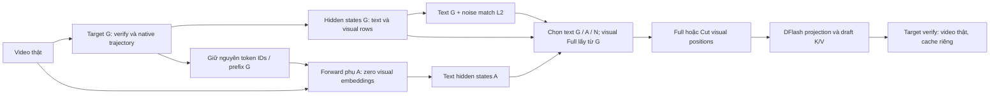

# Nghiên cứu Video-DFlash · tổng hợp ngày 6/11/2026

**Thông điệp hiện tại:** tác động visual context lên proposal phụ thuộc checkpoint/budget và metric. Chưa có bằng chứng causal xác nhận text states thay thế visual positions; pilot text-state đã chạy đủ nhưng feature audit chưa đạt.

Bộ báo cáo tổng hợp tuyến nghiên cứu đang theo dõi trong `proposed_exp.md`, gồm các campaigns cũ và các reanalysis gần đây. Ngày thư mục là mốc tổng hợp, không phải ngày chạy của tất cả studies. Lượt này dựng lại bảng/hình từ dữ liệu đã có, không chạy thêm model.

## Đọc và truy vết

| ID | Báo cáo | Phạm vi | Nguồn và trạng thái |
|---|---|---|---|
| 01 | [Visual budget, layer selection, retention](01_visual_budget_retention.md) | DFlash 5 configs, 6.000 cases theo báo cáo | Archived tables; raw campaign chưa có local |
| 02 | [Distribution replay](02_distribution_replay.md) | 50 video ×4 budgets; 200 pairs | Local summaries/audit; hạn chế loaded-bytecode provenance |
| 03 | [Prefix, first rejection và lexical risk set](03_prefix_first_rejection.md) | Reanalysis của đúng 200 pairs ở 02 | Exploratory; không phải replication độc lập |
| 04 | [Token ID × slot matched control](04_token_matched_control.md) | 24 video, 3K, 20 strata /188 matched positions | Exploratory reanalysis; interval chứa 0 |
| 05 | [Text-state intervention](05_textstate_intervention.md) | 12 video, 3K, G/A/N ×Full/Cut | **Audit matched-path đạt chuẩn (9/11/2026)**; xác nhận sụt giảm ~32% |
| 06 | [Depth, output progress, answer hint](06_depth_progress_hint.md) | H3.2/H3.1/E7-DFlash | Archived report; raw chưa local để tái audit |
| 07 | [DSpark và chi phí thực](07_dspark_cost_control.md) | Backend riêng, N=15, 360 cases | Audit/condition stats local; timing trích bảng nguồn; nonlossless |
| 08 | [Legacy và thiếu bằng chứng](08_legacy_va_thieu_bang_chung.md) | Text pruning, inference/epoch cũ, MSD, policies đều/trái/phải | Historical/qualitative; không gộp vào causal result |
| 09 | [Attention và output contract của campaign](09_attention_output_contract.md) | Campaign 5 configs: mass/density, caption metrics, speed | Archived tables; sửa phạm vi kết luận lossless trong báo cáo cũ |

Mỗi báo cáo chứa câu hỏi → thiết kế/metric → bảng/hình → phân tích/insight → giới hạn → links gốc. Có **18 hình**, mỗi hình lưu PNG 300 dpi và PDF vector; bảng số trích xuất và nguồn SHA256 nằm trong `results/report_bundle_20261106/`.

## Các insight có phạm vi rõ

| Insight | Bằng chứng | Giới hạn |
|---|---|---|
| Bỏ visual không tạo một hướng thay đổi acceptance chung | 01; prefix trong 03 | Visual-token budget chưa tách khỏi preprocessing/temporal difficulty |
| Phân phối proposal đổi nhiều hơn mean hit@1 | 02 | Không thay thế prefix acceptance hoặc speed |
| Lỗi sớm quyết định hiệu quả block | 03 | Quan sát trên checkpoint, block size và forced Full schedule đã dùng |
| Lexical proxy chưa đủ vững để gọi là grounding failure | 03→04 | Metric/cohort/risk set khác; không đọc đổi dấu như causal reversal |
| A giảm prefix agreement khoảng 32% trong số liệu đã chạy | 05 | Đã audit matched-path (9/11/2026, sai số previsual = 0.0); xác nhận bản chất mô hình |
| N khác A ở Full−Cut contrast theo hướng âm J | 05 | Không xác nhận predicted substitutability; một noise seed |
| Acceptance cần đi cùng output contract và timing | 07–08 | DSpark/legacy khác backend; chưa ngoại suy speed sang DFlash hiện tại |

## Quy ước phương pháp

| Thuật ngữ | Ý nghĩa trong bộ báo cáo |
|---|---|
| τ_proposal / prefix L | Số draft proposals đúng liên tiếp trước lỗi; chưa cộng target token |
| τ_effective | Prefix + một target token trên valid rounds theo runner; target token có thể là correction |
| Hit@1 / mismatch | Đúng/sai top-1 tại một vị trí, kể cả sau lỗi đầu; khác contiguous prefix |
| Hazard | Xác suất reject với điều kiện các slot trước đã đúng; risk set thay đổi theo condition |
| I/J ở study 05 | I=(Full−Cut)_A−(Full−Cut)_G; J=(Full−Cut)_A−(Full−Cut)_N |
| CI chứa 0 | Chưa phân biệt được contrast khác 0 theo phép ước lượng; chưa chứng minh tương đương |
| Archived | Số đã trích/làm tròn từ report; không tuyên bố raw-data audit hoặc chạy lại model |

Resampling tuân thủ đơn vị video của nguồn; không coi hàng nghìn positions là independent samples. Các CIs/intervals được lấy nguyên từ artifacts hoặc report nguồn, không dựng CIs giả cho các mean thiếu uncertainty. Nhiều contrasts exploratory chưa hiệu chỉnh đa kiểm định. Không gộp kết quả giữa GPUs/checkpoints, không gộp MSD/DSpark thành đối chứng causal của DFlash.



Sơ đồ mô tả thiết kế study 05. Zero visual embeddings khi tạo A không xóa thông tin đã nằm trong token IDs. Previsual feature discrepancy hiện khiến phép tách hai đường chưa đạt audit.

## Hướng tiếp theo theo bằng chứng

1. Audit cùng forward path và no-op trên 3 mẫu text-state lỗi +1 mẫu sạch; xác định numerical tolerance, causal positions và suffix invariance. Chỉ rerun outcome cohort 12 sau khi audit đạt.
2. Kiểm tra noise-seed robustness nếu matched capture hợp lệ; giữ metric và cohort, tránh chọn seed thuận lợi.
3. Dùng task có annotation event/order/counting và held-out evaluation để kiểm tra nhu cầu visual/temporal; lexical overlap chỉ là phân tích phụ.
4. Đo paired AR/Full/Cut timing, output parity, peak memory và answer quality trước khi chọn giải pháp retention/distillation.

## Chỉ mục thêm các báo cáo trước

Các nhánh dưới được giữ ở nơi báo cáo ban đầu; chưa gộp số vào các ước lượng của bộ này:

| Nhánh | Nơi tra cứu |
|---|---|
| Token acceptance, depth và hallucination tháng 10 | [Bộ ngày 6/10](../6_10_26/README.md) |
| Context selection | [Bộ ngày 19/10](../19_10_26/report.md) |
| Đối chiếu Sparrow/MSD với DFlash | [Bộ ngày 15/10](../Baocao_15_10_26/Dflash_Sparrow_exp/README.md) |
| Inference và chất lượng DFlash ban đầu | [Báo cáo inference tháng 8](../Baocao_26_8_26/Dflash_qwen25vl3b_final_paper_style_main/REPORT_FINAL.md) |

## Nguồn và tái tạo

- [Source manifest: đường dẫn gốc, SHA256 và snapshots](../../results/report_bundle_20261106/source_manifest.json).
- [Bản đồ các bảng trích từ báo cáo lịch sử](../../results/report_bundle_20261106/transcription_map.json).
- [Kiểm tra links/hình/bảng và hashes](../../results/report_bundle_20261106/report_validation.json).
- [Sổ tiến trình](../proposed_exp.md) giữ ngắn; bộ này lưu các diễn giải và bằng chứng chi tiết.

Từ root repository:

```bash
python markdown/6_11_26/figures/gen_fig_reports.py
python markdown/6_11_26/build_reports.py
```

Kiểm tra bundle bằng `python markdown/6_11_26/validate_reports.py`.

Hai script chỉ tạo bản tổng hợp. Nguồn đầu vào gốc được giữ nguyên; source snapshots thuộc lần build hiện hành. Plot labels dùng tiếng Anh, caption và phân tích dùng tiếng Việt. Hashes mô tả file tại thời điểm tổng hợp, gồm analyzer hiện hành; chúng không tự định danh loaded bytecode của lần chạy cũ. Các bảng historical giữ rounding nguồn; độ chính xác thêm chữ số trong tính tỷ lệ không tạo thêm bằng chứng.
