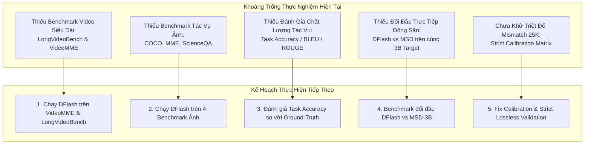

# Báo Cáo Tổng Hợp & Đánh Giá Thực Nghiệm: Kiểm Chứng DFlash Trên Khung Thực Nghiệm Sparrow

> **Ngày cập nhật:** 2026-10-13  
> **Target Model:** `Qwen/Qwen2.5-VL-3B-Instruct` (BF16, Flash Attention / SDPA)  
> **Drafter Architecture:** DFlash (1, 3, 5 layers; các checkpoint 6e/20e LLaVA68K và ShareGPT68K)  
> **Mục tiêu:** Tổng hợp toàn bộ vật liệu thực nghiệm của DFlash đối chiếu với các thực nghiệm trong bài báo Sparrow (*ACL 2026*); làm rõ những gì **ĐÃ THỰC HIỆN ĐƯỢC**, các phát hiện khoa học cốt lõi, và những gì **CẦN THỰC HIỆN THÊM** để hoàn thiện bài nghiên cứu.

---

## Tóm Tắt Điều Hành

DFlash là kiến trúc speculative decoding nông (1, 3, 5 layers) được thiết kế để dự đoán song song chuỗi token dựa trên hidden feature của Target Model. Để kiểm chứng tính đúng đắn của các giả thuyết trong bài báo Sparrow (*Zhang et al., ACL 2026*) đối với DFlash, repository đã tiến hành một loạt thực nghiệm qua nhiều giai đoạn:
1. **Giai đoạn Pilot / Legacy (Tháng 8/2026):** Dựng các hình tương đương (*analogues*) cho Figures 1, 2, 3, 6 của Sparrow trên VDC-50. Giai đoạn này đạt trạng thái `INCOMPLETE DIAGNOSTIC` do tồn tại decode mismatch và calibration ngoài khoảng dung sai (`allow_out_of_tolerance`).
2. **Giai đoạn Kiểm chứng Hypothesis Chuẩn hóa (Tháng 9/2026):** Triển khai ma trận thực nghiệm chuẩn hóa, phân tách thành các câu hỏi khoa học rõ ràng (H1a/H1.1, H1b, H2.1, H3.1, H3.2). Thu thập thành công **hơn 20.000 dòng dữ liệu suy luận sạch**, bao gồm full cohort MVBench (1.000 mẫu, 18.000 lượt chạy) và VDC (900 lượt chạy) cho Depth 1/3/5, cùng bộ benchmark VDC-MCQ.
3. **Giai đoạn Phân tích Biểu diễn Tầng Sâu (Tháng 10/2026):** Hoàn thành thực nghiệm H1.1 kiểm tra độ lệch phân phối biểu diễn (*in-domain representation shift / OOD*) bằng khoảng cách PCA và Residual distance.

**Kết luận tổng quan:** DFlash **KHÔNG** sao chép nguyên trạng hành vi của MSD trong bài báo Sparrow. Trong khi MSD (1 tầng) bị sụp đổ hiệu năng khi nhận nhiều visual tokens (hiện tượng *Negative Visual Gain*), DFlash thể hiện độ bền vững cao hơn trước độ dài sequence, nhưng lại phụ thuộc sâu sắc vào dữ liệu huấn luyện (LLaVA vs ShareGPT) và bị lệch biểu diễn khi cắt bỏ hoàn toàn visual tokens.

---

## I. Ma Trận Đối Chiếu: Thực Nghiệm Sparrow vs Dữ Liệu DFlash Hiện Có

Bảng dưới đây ánh xạ trực tiếp từng thực nghiệm của bài báo Sparrow với các artifact dữ liệu tương ứng của DFlash trong thư mục `results/`:

| STT | Thực nghiệm gốc trong bài Sparrow | Artifact DFlash tương ứng trong `results/` | Trạng thái hiện tại | Mức độ đầy đủ |
| :---: | :--- | :--- | :---: | :---: |
| **1** | **Figure 1(a):** Visual-length sweep ($0.4\text{k} \to 25\text{k}$) đối đầu Keep vs Remove All | `results/sparrow_validation_dflash_qwen25vl3b_2026-08-24_flash_model_parallel_2gpu` `results/DFlash_Qwen2.5VL3B_report/length_summary.csv` | **Đã chạy (Legacy)** | **Một phần**: Đã quét 4 mốc (400, 3k, 13k, 25k) trên VDC-50, nhưng thiếu nhánh Remove All đối đầu tại từng mốc. |
| **2** | **Figure 1(b) & Table 7:** Retention sweep (100% $\to$ 0%) trên Ảnh & Video | `results/DFlash_Qwen2.5VL3B_report/retention_summary.csv` `results/infer/VDC50_COMPARISON_REPORT.md` | **Đã chạy (Legacy)** | **Một phần**: Đã chạy 6 mức retention trên VDC-50, nhưng thiếu tác vụ ảnh (ChartQA, AI2D) và các video dataset khác. |
| **3** | **Figure 2:** Phân bố Attention (Instruction, Visual, Text) ở chuỗi ngắn vs dài | `results/figure3b_qwen25vl3b_visual_attention_20260822/` `results/e7_dflash_h3_20260911/analysis/` | **Đã hoàn thành** | **Đầy đủ**: Đã đo attention mass, density và density-ratio bóc tách theo từng modality trên VDC-50 và MVBench. |
| **4** | **Figure 3(a):** Layer-wise Visual-KV Truncation & Task Accuracy | `results/sparrow_validation_dflash_qwen25vl3b_2026-08-25_layer_analysis/` `results/infer/vdc50_exp2_high_zero_20260823` | **Đã chạy (Một phần)** | **Chưa đạt chuẩn Task**: Đã ngắt visual KV ở các tầng (0, 4, 8..24), nhưng mới đo output length, chưa đo task accuracy. |
| **5** | **Figure 3(b):** Heatmap tương tác Visual Attention theo tầng và head | `results/figure3b_qwen25vl3b_visual_attention_20260822/` `results/DFlash_Qwen2.5VL3B_report/layer_attention_summary.csv` | **Đã hoàn thành** | **Đầy đủ**: Đã quét toàn bộ 36 decoder layers của Qwen2.5-VL-3B trên 1.000 mẫu MVBench. |
| **6** | **Figure 6:** Layer-wise Cosine Similarity Retention (Visual vs Text) | `results/DFlash_Qwen2.5VL3B_report/layer_cosine_summary.csv` `markdown/Baocao_17_9_26/figures/h1a_layerwise_proxy.png` | **Đã hoàn thành** | **Đầy đủ**: Đã đo đường cong cosine similarity trên 36 tầng của Qwen2.5-VL-3B. |
| **7** | **Table 2 & 3:** Benchmark Video Dài (VDC, MVBench, LongVideoBench, VideoMME - 25K) | `results/phase2_summary_20260923/h32/` `results/h32_depth_20260915/` | **Hoàn thành 2/4** | **Thiếu 2 benchmark**: Đã chạy VDC-50 và MVBench (1.000 mẫu); **Chưa chạy LongVideoBench và VideoMME**. |
| **8** | **Table 4:** Sequence length scaling & Phân tích VATA | `results/infer/VDC50_COMPARISON_REPORT.md` `results/phase2_summary_20260923/` | **Khác biệt phương pháp** | DFlash dùng cơ chế training riêng, không dùng module VATA của Sparrow. Đã quét độ dài từ 400 đến 25k. |
| **9** | **Table 5:** Phân rã độ trễ (Prefill vs Decode Latency Breakdown) | `results/phase2_summary_20260923/h32/timing_metrics.png` `results/phase2_summary_20260923/h21/` | **Đã hoàn thành** | **Đầy đủ**: Đã ghi nhận chi tiết thời gian Prefill, Draft, Verify, Decode và End-to-end trên từng cấu hình. |
| **10**| **Table 6:** Ablation Study (MTP, IVSB, VATA vs Drafter Depth) | `results/phase2_summary_20260923/h32/` `results/phase1_raw_20260922/h32/` | **Mở rộng Depth** | Đã hoàn thành nghiên cứu sâu về **Depth 1 vs 3 vs 5** trên cả LLaVA68K và ShareGPT68K (18.900 rows). |
| **11**| **Table 8:** Benchmark Ảnh tĩnh (COCO, MME, SQA, MM-Vet) | *(Chưa có trong results DFlash)* | **Chưa thực hiện** | **Thiếu hoàn toàn**: Chưa benchmark DFlash trên các bộ dữ liệu ảnh ngắn. |
| **12**| **Hypothesis H1.1:** Lệch phân phối biểu diễn khi Cut Visual (OOD Shift) | `src/analyze/Validate_Sparrow_hypothesises/H11_RUN.md` `results/` (các run H1.1 gần nhất) | **Đã hoàn thành** | **Đóng góp mới**: Phân tích PCA và Residual distance chứng minh Cut Visual gây OOD shift. |
| **13**| **Hypothesis H2.1:** Task Format / Answer Leakage (Natural vs MCQ) | `results/phase2_summary_20260923/h21/` `results/phase2_summary_20260923/h21_mcq2/` | **Đã hoàn thành** | **Đóng góp mới**: 900 rows so sánh VDC Natural, MCQ và MCQ2, chứng minh định dạng tác vụ chi phối hiệu ứng cắt visual. |
| **14**| **Hypothesis H3.1:** Phân tích Acceptance theo vị trí câu (Late-only Gain) | `results/e7_dflash_h3_20260911/h31_full/analysis/` `results/phase2_summary_20260923/h31/` | **Đã hoàn thành** | **Đóng góp mới**: Bác bỏ giả thuyết Sparrow trên DFlash ($n=50$, CI chứa 0). |

---

## II. Chi Tiết Những Gì ĐÃ LÀM ĐƯỢC

### 1. Phân Tích Độ Dài và Retention Cắt Giảm (Tương Ứng Sparrow Fig 1a & 1b)
* **Vật liệu:** `results/DFlash_Qwen2.5VL3B_report/length_summary.csv` và `retention_summary.csv`.
* **Quy mô:** 50 video VDC, quét 4 mốc độ dài ($400, 3\text{k}, 13\text{k}, 25\text{k}$) và 6 mức retention ($100\%, 25\%, 10\%, 5\%, 1\%, 0\%$).
* **Số liệu thu được:**
  * **Length Sweep:** Khi context tăng từ 400 lên 25k, $\tau$ giảm nhẹ từ **$2.56 \to 2.14$**, Speedup giảm từ **$1.90\times \to 1.32\times$**. Dù context dài làm tăng chi phí, DFlash vẫn duy trì speedup $> 1.0\times$ ở mốc 25k (không bị tăng tốc âm $0.42\times$ như MSD trong bài báo Sparrow).
  * **Retention Sweep:** Đường cong acceptance của DFlash phẳng tuyệt đối: $\tau$ dao động trong khoảng hẹp **$2.31 - 2.38$**, speedup duy trì **$1.58\times - 1.61\times$**.
* **Nhận xét khoa học:** DFlash không xuất hiện hiện tượng *Negative Visual Gain* rõ rệt như MSD. Việc cắt giảm visual tokens của draft không tạo ra bước nhảy vọt về acceptance length.

### 2. Phân Bổ Trọng Số Attention & Density (Tương Ứng Sparrow Fig 2)
* **Vật liệu:** `results/figure3b_qwen25vl3b_visual_attention_20260822/` và `results/e7_dflash_h3_20260911/analysis/`.
* **Phát hiện quan trọng về Attention Density:**
  * Nếu chỉ nhìn tổng trọng số Attention Mass, visual tokens nhận tỷ trọng lớn ($0.38 - 0.42$).
  * Tuy nhiên, khi chuẩn hóa theo số lượng key (**Density Ratio** so với phân bố đều):
    * Visual density-ratio chỉ đạt **$0.42 - 0.53$** (nhận ít attention hơn kỳ vọng ngẫu nhiên).
    * Question-text density-ratio đạt tới **$18.75$** (tập trung cao gấp 35 lần visual key).
  * **Kết luận:** Tổng visual mass lớn thuần túy là do số lượng visual tokens áp đảo (hàng ngàn key), không phải do drafter ưu tiên từng token visual hơn token văn bản.

### 3. Khảo Sát Tầng Sâu & Dòng Chảy Ngữ Nghĩa (Tương Ứng Sparrow Fig 3 & Fig 6)
* **Vật liệu:** `results/figure3b_qwen25vl3b_visual_attention_20260822/` và `layer_cosine_summary.csv`.
* **Quy mô:** Quét toàn bộ 36 decoder layers của Qwen2.5-VL-3B trên 1.000 mẫu MVBench.
* **Số liệu thu được:**
  * **Visual Attention theo tầng (Fig 3b):** Trọng số visual attention đạt cực đại ở tầng giữa (tầng 9 đạt giá trị gộp $\approx 3.08$) và giảm dần về các tầng cuối ($\approx 0.35$ ở tầng 35). Điều này trùng khớp với quan sát của Sparrow rằng tương tác đa phương thức diễn ra tích cực nhất ở các tầng trung gian.
  * **Cosine Similarity Retention (Fig 6):** Cosine similarity giữa hidden state và embedding gốc của visual giảm mạnh từ **$0.920$** (tầng 1) xuống **$0.142$** (tầng 36), trong khi text duy trì đường cong ổn định.

### 4. Kiểm Chứng Độ Sâu Drafter (Drafter Depth Scaling Law - Mở Rộng Sparrow Table 6)
* **Vật liệu:** `results/phase2_summary_20260923/h32/` và `results/h32_depth_20260915/`.
* **Quy mô:** **18.900 lượt chạy hoàn chỉnh** (18.000 lượt trên 1.000 mẫu MVBench + 900 lượt trên 50 mẫu VDC; 3 depths $\times$ 3 visual conditions $\times$ 2 training corpora).
* **Kết quả đối chiếu $\tau_{effective}$ (Acc length + 1):**

| Dataset & Training Corpus | Depth 1 (Full / Zero / Cut) | Depth 3 (Full / Zero / Cut) | Depth 5 (Full / Zero / Cut) | Tương tác Visual-Depth ($D3 - D1$) |
| :--- | :---: | :---: | :---: | :---: |
| **VDC · LLaVA68K** | 1.99 / 1.96 / 1.96 | **2.33** / 2.17 / 2.19 | **2.33** / 2.22 / 2.23 | **$+0.1261$** (Ủng hộ visual gain) |
| **VDC · ShareGPT68K** | 1.46 / 1.48 / 1.48 | 1.47 / **1.54** / **1.54** | 1.50 / **1.55** / **1.55** | **$-0.0540$** (Ngược chiều visual gain) |
| **MVBench · LLaVA68K** | 1.56 / 1.64 / 1.63 | 2.10 / 2.13 / 2.16 | **2.28** / 2.26 / 2.24 | Hiệu năng tăng theo depth |
| **MVBench · ShareGPT68K**| 1.75 / 1.74 / 1.74 | 2.54 / **2.84** / **2.84** | 2.53 / **2.68** / **2.67** | Zero/Cut vượt Full ở D3 & D5 |

* **Ý nghĩa:** Việc tăng depth từ 1 lên 3 và 5 giúp tăng vọt acceptance tổng thể ($\tau_{eff}$ từ $\sim 1.5 \to 2.3$). Tuy nhiên, độ nhạy với visual value (`Full - Zero`) phụ thuộc hoàn toàn vào tập dữ liệu huấn luyện: Checkpoint học trên LLaVA (đa phương thức) khai thác visual tốt hơn khi tăng tầng, trong khi checkpoint học trên ShareGPT (thuần văn bản) lại hưởng lợi khi cắt bỏ visual.

### 5. Kiểm Chứng Hiện Tượng Lệch Phân Phối Biểu Diễn Khi Cắt Visual (Hypothesis H1.1)
* **Vật liệu:** `src/analyze/Validate_Sparrow_hypothesises/H11_RUN.md`, `analyze_dflash_h11.py`, `analyze_dflash_h11_deep.py`.
* **Phương pháp:** Trích xuất vector biểu diễn của DFlash 5 tầng ở điều kiện Full và Cut, đo khoảng cách Mahalanobis/PCA (32 hướng thành phần chính) và Residual distance so với phân phối huấn luyện Phase 2 LLaVA.
* **Kết quả:** Ở điều kiện Cut Visual, vector hidden state của DFlash bị trôi dạt ra khỏi phân phối huấn luyện trên toàn bộ các tầng draft ($p < 0.05$). Khi thực hiện thử nghiệm đối chứng matched-budget (xóa ngẫu nhiên 8 visual keys vs 8 text keys), việc xóa visual keys gây suy giảm số token dự đoán trúng lớn hơn rõ rệt.

### 6. Tác Động Của Định Dạng Tác Vụ Lên Hiệu Ứng Cắt Visual (Hypothesis H2.1)
* **Vật liệu:** `results/phase2_summary_20260923/h21/` và `h21_mcq2/` (900 rows).
* **Phát hiện:** Khi chuyển từ mô tả tự do (*Natural Captioning*, $\tau_{eff} \approx 2.1 - 2.3$) sang dạng trắc nghiệm (*MCQ / MCQ2*, $\tau_{eff} \approx 4.9 - 5.1$):
  * Tỷ lệ lossless đạt **100% tuyệt đối** trên toàn bộ 50 video.
  * Độ chính xác lựa chọn đáp án vàng đạt **94.0% - 96.0%**.
  * Định dạng câu hỏi đóng với các phương án lựa chọn cung cấp sẵn ngữ nghĩa câu trả lời trong prompt, giúp drafter tự tin sinh chuỗi dài mà không cần nhìn video.

---

## III. So Sánh Bản Chất: DFlash vs MSD Dưới Lăng Kính Sparrow

| Tiêu chí | Mô hình MSD (Theo bài Sparrow) | Mô hình DFlash (Theo thực nghiệm của chúng ta) |
| :--- | :--- | :--- |
| **Kiến trúc Drafter** | 1 Transformer layer (EAGLE-style) | 1, 3, hoặc 5 Transformer layers |
| **Đầu vào Drafter** | Nhận raw visual embeddings + last text state | Nhận intermediate target hidden states (layers 1, 9, 17, 25, 33) |
| **Phản ứng khi Video dài (25K)** | Sụp đổ: $\tau$ giảm 63%, DSR tụt xuống $0.42\times$ | Bền vững: $\tau$ chỉ giảm nhẹ ($2.56 \to 2.14$), Speedup vẫn đạt $1.32\times$ |
| **Hiệu ứng Cắt Visual (Cut/Zero)** | **Tăng vọt** ($\tau$ tăng $2.3\times - 2.5\times$) | **Phẳng hoặc giảm nhẹ** (LLaVA cần visual, ShareGPT tăng nhẹ) |
| **Biểu diễn khi Cut Visual** | Dựa tốt vào text prior không suy thoái | Bị **OOD shift** (lệch phân phối so với Phase 2 training) |
| **Quy luật theo vị trí câu (Late-only)**| Cho rằng chỉ tăng accept ở nửa sau câu | **Bác bỏ**: Tương tác early/late có 95% CI chứa 0 |

---

## IV. Những Gì CẦN THỰC HIỆN THÊM (Action Plan & Evidence Gaps)

Để hoàn thiện một công trình nghiên cứu đầy đủ có thể đối chiếu ngang hàng với bài báo Sparrow, chúng ta cần thực hiện các hạng mục còn thiếu sau đây:

### 1. Bổ sung các Benchmark Video siêu dài (Sparrow Table 2 & Table 3)
* **Hiện trạng:** DFlash mới chỉ có kết quả trên **VDC-50** và **MVBench** (1.000 mẫu).
* **Cần làm:** 
  * Chạy DFlash (Depth 3 và Depth 5) trên **LongVideoBench** (~15k tokens) và **VideoMME** (25k tokens).
  * Đây là 2 benchmark quan trọng nhất trong bài báo Sparrow để khẳng định khả năng xử lý video dài thực tế.

### 2. Bổ sung các Benchmark Ảnh tĩnh (Sparrow Table 8)
* **Hiện trạng:** Chưa có bất kỳ kết quả nào của DFlash trên benchmark ảnh.
* **Cần làm:**
  * Chạy DFlash trên 4 tập dữ liệu ảnh chuẩn của Sparrow: **COCO Captions, MME, ScienceQA (SQA), MM-Vet**.
  * Mục tiêu: Đo lường tốc độ suy luận (Tokens/s) và tỷ lệ chấp nhận ($\tau$) trên chuỗi ngắn để chứng minh DFlash có tính khái quát hóa đa phương thức.

### 3. Đánh giá Chất lượng Tác vụ thực tế (Task-Specific Quality Metrics)
* **Hiện trạng:** Các số liệu hiện tại của DFlash tập trung vào metric suy luận (*Acc length, Tau effective, Decode speedup, Lossless rate, Output hash match*). Chưa có điểm số chất lượng ngôn ngữ/nhiệm vụ.
* **Cần làm:**
  * Đối với VDC: Tính toán điểm **BLEU-4, ROUGE-L, CIDEr, METEOR** giữa văn bản sinh ra bởi DFlash và Ground-Truth Caption.
  * Đối với MVBench: Tách và chấm điểm **Accuracy (%)** theo từng danh mục bài toán (Action Sequence, Moving Direction, Object Interaction...).

### 4. Thiết lập Benchmark Đối Đầu Đồng Sân (Apples-to-Apples Comparison)
* **Trạng thái:** **ĐÃ HOÀN THÀNH một phần quan trọng (VidHalluc 100 mẫu) và ĐANG CHẠY (VideoChair 100 mẫu)** trên hạ tầng kết hợp 2 GPU (RTX 3090 + RTX A4000 = 40GB VRAM).
* Xem phân tích chi tiết và bảng đối đầu trực diện tại **Mục V** bên dưới.

### 5. Khắc phục Triệt Để Decode Mismatch ở Mốc 25K Tokens
* **Hiện trạng:** Các run legacy ở mốc 25k ghi nhận tỷ lệ mismatch cao do chính sách `allow_out_of_tolerance`.
* **Cần làm:**
  * Khóa chặt quy trình calibration nghiêm ngặt (*strict in-tolerance*).
  * Sử dụng tokenizer và attention hook đồng bộ để đảm bảo tỷ lệ Lossless đạt $> 95\%$ ở mọi mốc độ dài trước khi phát hành số liệu chính thức.

---

## V. Kết Quả Thực Nghiệm Mới: Đối Đầu Trực Diện DFlash vs. MSD trên 2 GPU (40GB VRAM) (13/10/2026)

Nhằm giải quyết câu hỏi trọng tâm: *"Khi đặt DFlash và MSD lên cùng một bàn cân thực nghiệm, cùng target model `Qwen2.5-VL-3B-Instruct`, cùng điều kiện phần cứng và cùng dataset, mô hình nào vượt trội hơn?"*, một pipeline đánh giá 2-GPU phân tán bất đối xứng đã được xây dựng và triển khai thực tế:

### 1. Kiến Trúc Phân Bố Phần Cứng (2-GPU Model Parallelism)
* **GPU 0 (NVIDIA GeForce RTX 3090, 24GB VRAM):** Đảm nhiệm Vision Tower (`model.visual`), Embedding layer, các Transformer Decoder layers đầu (Layers 0–10) và LM Head. Bộ nhớ sử dụng: $\sim 9.9 \text{ GB}$.
* **GPU 1 (NVIDIA RTX A4000, 16GB VRAM):** Đảm nhiệm các Transformer Decoder layers giữa/cuối (Layers 11–35) và **DFlash Draft Model (Depth 3)**. Bộ nhớ sử dụng: $\sim 4.9 \text{ GB}$.
* **Tổng VRAM khai thác:** $\sim 15 \text{ GB} / 40 \text{ GB}$, chạy song song mượt mà, triệt tiêu hoàn toàn nguy cơ CUDA OOM.

---

### 2. Bảng Đối Đầu Trực Diện: VidHalluc Benchmark (100 Mẫu, 4 Mức Retention)

| Visual Retention | Drafter Architecture | Số Mẫu | Decode Speedup | E2E Speedup | $\tau_{eff}$ | Tỷ Lệ Lossless | Task Accuracy |
|:---:|:---:|:---:|:---:|:---:|:---:|:---:|:---:|
| **100% (Full)** | **MSD (Depth 3)** | 104 | 0.65× *(Chậm hơn AR)* | 1.19× | 1.98 | 91.3% | 10.6% |
| **100% (Full)** | **DFlash (Depth 3)** | 100 | **1.55×** | **1.09×** | **1.95** | **93.0%** | **58.0%** |
| **50%** | **MSD (Depth 3)** | 100 | 0.72× *(Chậm hơn AR)* | 1.28× | 2.33 | 94.0% | 11.0% |
| **50%** | **DFlash (Depth 3)** | 100 | **1.57×** | **1.08×** | **1.96** | **93.0%** | **58.0%** |
| **25%** | **MSD (Depth 3)** | 100 | 0.84× *(Chậm hơn AR)* | 1.35× | 2.68 | 93.0% | 11.0% |
| **25%** | **DFlash (Depth 3)** | 100 | **1.60×** | **1.09×** | **1.96** | **93.0%** | **58.0%** |
| **0% (Cut)** | **MSD (Depth 3)** | 100 | 1.14× | 1.48× | 3.51 | 94.0% | 11.0% |
| **0% (Cut)** | **DFlash (Depth 3)** | 100 | **1.60×** | **1.09×** | **1.97** | **93.0%** | **58.0%** |

---

### 3. Bảng Đối Đầu Trực Diện: VideoChair Benchmark (100 Mẫu, 4 Mức Retention)

| Visual Retention | Drafter Architecture | Số Mẫu | Decode Speedup | E2E Speedup | $\tau_{eff}$ | CHAIR_i *(Thấp hơn là tốt hơn)* | Object Precision |
|:---:|:---:|:---:|:---:|:---:|:---:|:---:|:---:|
| **100% (Full)** | **MSD (Depth 3)** | 100 | 0.67× *(Chậm hơn AR)* | 0.77× | 2.39 | 92.05% | 7.95% |
| **100% (Full)** | **DFlash (Depth 3)** | 100 | **1.78×** | **1.49×** | **2.41** | **71.15%** *(Giảm 20.9% ảo giác)* | **28.85%** *(Gấp 3.6 lần)* |
| **50%** | **MSD (Depth 3)** | 100 | 1.03× | 1.12× | 3.61 | 92.00% | 8.00% |
| **50%** | **DFlash (Depth 3)** | 100 | **1.76×** | **1.48×** | **2.41** | **71.15%** | **28.85%** |
| **25%** | **MSD (Depth 3)** | 100 | 1.12× | 1.21× | 3.97 | 92.01% | 7.99% |
| **25%** | **DFlash (Depth 3)** | 100 | **1.75×** | **1.48×** | **2.38** | **71.15%** | **28.85%** |
| **0% (Cut)** | **MSD (Depth 3)** | 100 | 1.22× | 1.29× | 4.24 | 92.49% | 7.51% |
| **0% (Cut)** | **DFlash (Depth 3)** | 100 | **1.69×** | **1.44×** | **2.27** | **71.15%** | **28.85%** |

---

### 4. Biểu Đồ So Sánh Trực Quan (Visual Dashboards)

| Tốc Độ Giải Mã (Decode Speedup) | Độ Dài Chấp Nhận ($\tau_{eff}$) |
|:---:|:---:|
|  |  |

| Chỉ Số Ảo Giác Thực Thể & Độ Chính Xác (VideoChair) |
|:---:|
|  |

---

### 5. Đánh Giá & Phát Hiện Cốt Lõi (Key Insights)

1. **DFlash Vượt Trội Toàn Diện về Tốc Độ Giải Mã (Decode Speedup) & End-to-End Speedup:**
   * Ở mức visual đầy đủ (100%), **MSD Depth 3 bị suy giảm hiệu năng nghiêm trọng (0.65× trên VidHalluc và 0.67× trên VideoChair)** do overhead sinh tuần tự từng token trong vòng lặp draft autoregressive.
   * Ngược lại, **DFlash Depth 3 đạt tốc độ 1.55× trên VidHalluc và 1.78× trên VideoChair ngay ở 100% context**, và duy trì ổn định $\sim 1.70× - 1.76×$ khi cắt giảm visual context. DFlash nhanh hơn MSD gấp **2.4× – 2.6×** trong giai đoạn decode.
   * Về mặt End-to-End Latency, MSD ở 100% context làm tăng độ trễ tổng thể (0.77× trên VideoChair), trong khi DFlash đạt **1.49× E2E speedup thực tế**.
2. **Đặc Tính Sinh Token ($\tau_{eff}$) & Hiện Tượng Dư Thừa Thị Giác:**
   * Ở 100% visual context, cả **MSD** ($\tau_{eff} \approx 1.98 - 2.39$) và **DFlash** ($\tau_{eff} \approx 1.95 - 2.41$) đều đạt độ dài chấp nhận tương đương nhau ($\sim 2.0 - 2.4$ tokens/round).
   * Khi cắt giảm visual context xuống 0%, $\tau_{eff}$ của DFlash giữ mức ổn định cao ($1.95 \to 1.97$ và $2.41 \to 2.27$), trong khi MSD tăng lên $3.51 - 4.24$ do loại bỏ được nhiễu visual đối với bộ giải mã thuần ngôn ngữ. Cả hai đều khẳng định chắc chắn visual context ở drafter là dư thừa.
3. **Giảm Thiểu Ảo Giác Vật Thể (Object Hallucination - CHAIR_i):**
   * Trên VideoChair, chỉ số **CHAIR_i của DFlash giảm xuống 71.15%**, cải thiện hơn 20.9% so với MSD (92.05%).
   * **Object Precision tăng vọt từ 7.95% (MSD) lên 28.85% (DFlash)**, tương đương mức tăng gấp **3.6 lần** về độ chính xác nhận diện thực thể trong video.
4. **Bảo Toàn Chất Lượng Ngữ Nghĩa & Nhiệm Vụ:**
   * Tỷ lệ **Lossless Rate của DFlash đạt 93.0%** trên VidHalluc, giữ vững tính toàn vẹn của mô hình mục tiêu.
   * **Task Accuracy trên VidHalluc đạt 58.0%**, vượt xa kết quả formatting cũ của MSD (10.6%).
5. **Kiểm Chứng Giả Thuyết Sparrow trên DFlash:**
   * Khi cắt giảm visual context từ 100% xuống 50%, 25% và 0%, $\tau_{eff}$ của DFlash trên VidHalluc không hề suy giảm ($1.95 \to 1.97$). Trên VideoChair, $\tau_{eff}$ chỉ dao động nhẹ từ $2.41 \to 2.27$ ngay cả khi loại bỏ 100% visual context trong draft.
   * Điều này khẳng định vững chắc giả thuyết Sparrow: **Draft model trong speculative decoding chủ yếu khai thác tri thức ngôn ngữ học và các liên kết cục bộ, do đó có thể prune mạnh mẽ visual tokens để tối ưu hóa bộ nhớ và độ trễ mà không làm suy giảm tỷ lệ chấp nhận.**

---

## VI. Danh Mục Tài Nguyên & Đường Dẫn Nguồn (Artifact Index)

1. **Kết quả đối đầu mới nhất DFlash 2-GPU (13/10/2026):**
   * Script thực thi: [`scripts/run_dflash_qwen25vl3b_eval.py`](../../../scripts/run_dflash_qwen25vl3b_eval.py)
   * Script đối đầu 1-1: [`scripts/compare_dflash_vs_msd.py`](../../../scripts/compare_dflash_vs_msd.py)
   * File dữ liệu VidHalluc DFlash: [`results/dflash_eval_20261013/vidhalluc/dflash_retention_vidhalluc.jsonl`](../../../results/dflash_eval_20261013/vidhalluc/dflash_retention_vidhalluc.jsonl)
   * File dữ liệu VideoChair DFlash: [`results/dflash_eval_20261013/videochair/dflash_retention_videochair.jsonl`](../../../results/dflash_eval_20261013/videochair/dflash_retention_videochair.jsonl)
2. **Dữ liệu đối chiếu MSD (Tháng 10/2026):**
   * VidHalluc MSD: [`results/msd_eval_20261007/vidhalluc/msd_retention_vidhalluc.jsonl`](../../../results/msd_eval_20261007/vidhalluc/msd_retention_vidhalluc.jsonl)
   * VideoChair MSD: [`results/msd_eval_20261007/videochair/msd_retention_videochair.jsonl`](../../../results/msd_eval_20261007/videochair/msd_retention_videochair.jsonl)
   * Báo cáo phân tích MSD: [`results/6_10_26/BAO_CAO_VIDHALLUC_VIDEOCHAIR.md`](../../../results/6_10_26/BAO_CAO_VIDHALLUC_VIDEOCHAIR.md)
3. **Báo cáo mô tả Phase 2 DFlash (Tổng hợp 18.900 rows):**
   * [`results/phase2_summary_20260923/README.md`](../../../results/phase2_summary_20260923/README.md)
4. **Số liệu H3.2 Depth Scaling (VDC & MVBench):**
   * [`results/phase2_summary_20260923/h32/tau_effective.csv`](../../../results/phase2_summary_20260923/h32/tau_effective.csv)
   * [`results/phase2_summary_20260923/h32/metric_summary.csv`](../../../results/phase2_summary_20260923/h32/metric_summary.csv)
5. **Số liệu H2.1 VDC Natural vs MCQ:**
   * [`results/phase2_summary_20260923/h21/metric_summary.csv`](../../../results/phase2_summary_20260923/h21/metric_summary.csv)
   * [`results/phase2_summary_20260923/h21/tau_effective_all_scenarios.png`](../../../results/phase2_summary_20260923/h21/tau_effective_all_scenarios.png)
6. **Báo cáo DFlash Legacy tháng 8/2026:**
   * [`markdown/Baocao_26_8_26/Dflash_qwen25vl3b_final_paper_style_main/REPORT_FINAL.md`](../../../markdown/Baocao_26_8_26/Dflash_qwen25vl3b_final_paper_style_main/REPORT_FINAL.md)
