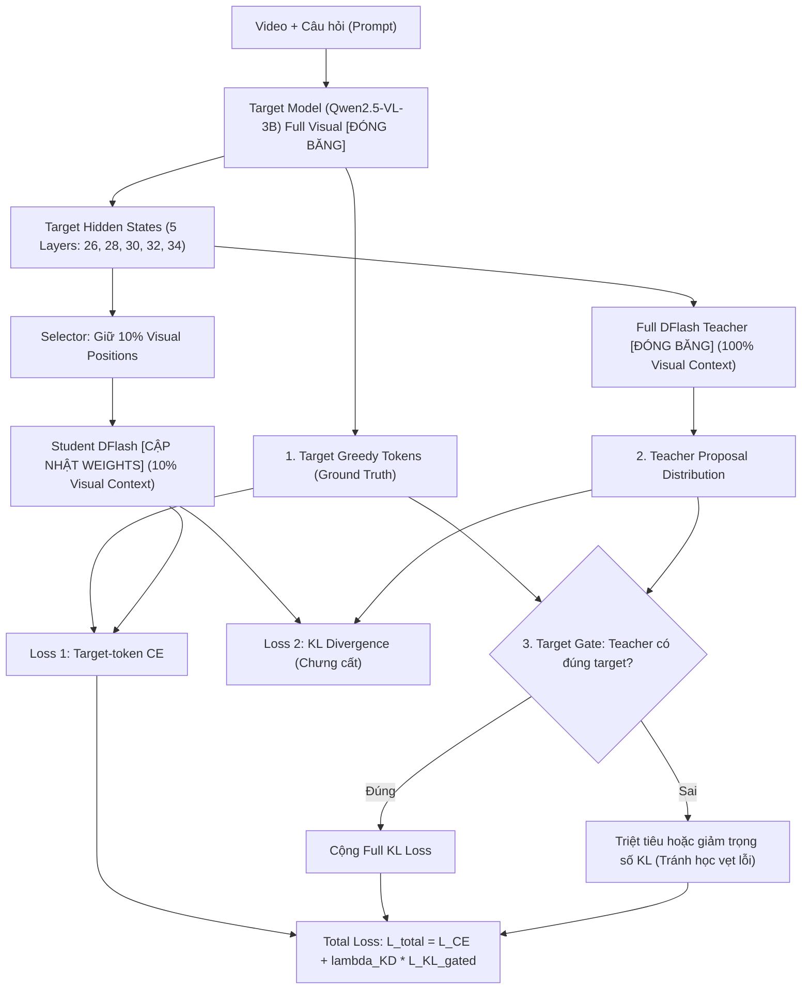
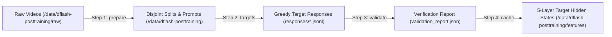

# Hướng Dẫn Thực Nghiệm Toàn Diện: Huấn Luyện DFlash Visual-10% Self-Distillation Trên Server B200

Tài liệu này cung cấp quy trình chuẩn hóa từ đầu đến cuối (End-to-End SOP) để triển khai thực nghiệm **Self-Distillation 10% Visual DFlash** trên kiến trúc **Qwen2.5-VL-3B-Instruct** sử dụng hệ thống server GPU NVIDIA B200 (hoặc cụm GPU tương đương).

---

> [!TIP]
> ### 🚀 CÁCH CHẠY 1 LỆNH TỰ ĐỘNG DUY NHẤT (Dành cho người nhận chuyển giao)
> Mọi bước tải dữ liệu, tiền xử lý, feature caching, tạo config và training đã được tự động hóa hoàn toàn vào script [`scripts/run_visual10_selfdistill_b200.sh`](file:///home/tuantb/VDFlash/scripts/run_visual10_selfdistill_b200.sh). Người thực hiện chỉ cần mở terminal trên server và gõ:
>
> ```bash
> # 1. Chạy thử nhanh Smoke Test (15 steps) để kiểm tra GPU & FlexAttention:
> bash scripts/run_visual10_selfdistill_b200.sh --smoke
>
> # 2. Hoặc chạy thẳng Full Production Training (Tự tải data -> Preprocess -> Cache -> Train FSDP -> Eval):
> bash scripts/run_visual10_selfdistill_b200.sh
> ```
> *Script tự động nhận diện số lượng GPU B200 trên máy (`nvidia-smi`), tự tải các asset thiếu từ Hugging Face, tự chia partition feature cache và tự khởi chạy `torchrun` mà không cần người dùng phải chỉnh sửa file code nào.*

---

## Mục Lục
1. [Kiến Trúc & Cơ Chế Huấn Luyện 3 Tín Hiệu](#1-kiến-trúc--cơ-chế-huấn-luyện-3-tín-hiệu)
2. [Giai Đoạn 1: Kiểm Tra & Chuẩn Bị Môi Trường Server B200](#giai-đoạn-1-kiểm-tra--chuẩn-bị-môi-trường-server-b200)
3. [Giai Đoạn 2: Tải Dữ Liệu & Checkpoints Từ Hugging Face](#giai-đoạn-2-tải-dữ-liệu--checkpoints-từ-hugging-face)
4. [Giai Đoạn 3: Tiền Xử Lý Dữ Liệu & Offline Feature Caching](#giai-đoạn-3-tiền-xử-lý-dữ-liệu--offline-feature-caching)
5. [Giai Đoạn 4: Chạy Smoke Test (Kiểm Tra FlexAttention & Dataloader)](#giai-đoạn-4-chạy-smoke-test-kiểm-tra-flexattention--dataloader)
6. [Giai Đoạn 5: Huấn Luyện Full-Scale](#giai-đoạn-5-huấn-luyện-full-scale)
7. [Giai Đoạn 6: Đánh Giá & Đo Đạc Acceptance Length ($\tau$)](#giai-đoạn-6-đánh-giá--đo-đạc-acceptance-length-tau)
8. [Xử Lý Lỗi Thường Gặp (Troubleshooting)](#xử-lý-lỗi-thường-gặp-troubleshooting)

---

## 1. Kiến Trúc & Cơ Chế Huấn Luyện 3 Tín Hiệu

Phương pháp Self-Distillation visual-10% giải quyết triệt để nút thắt conditioning cost khi xử lý video dài bằng cách huấn luyện một DFlash student chỉ nhận **10% visual context** (lấy mẫu theo trục temporal-spatial đều) kết hợp toàn bộ text context.



---

## Giai Đoạn 1: Kiểm Tra & Chuẩn Bị Môi Trường Server B200

### 1.1. Yêu cầu hệ thống
- **Hệ điều hành**: Linux x86_64 (Ubuntu 22.04 LTS khuyến nghị).
- **Phần cứng**: Tối thiểu 2x NVIDIA B200 (Blackwell SXM / PCIe) hoặc tương đương.
- **CUDA & Driver**: CUDA $\ge 12.4$ / Driver R550+.
- **Python**: 3.10 hoặc 3.11/3.12.

### 1.2. Kiểm tra GPU & Interconnect
```bash
# 1. Kiểm tra trạng thái GPU và Driver
nvidia-smi

# 2. Kiểm tra kết nối NVLink P2P giữa các card B200
nvidia-smi topo -m
```

### 1.3. Thiết lập Môi trường & Cài đặt Thư viện
Từ thư mục gốc của repository:
```bash
cd /home/tuantb/VDFlash

# Kích hoạt virtualenv (hoặc conda)
source .venv/bin/activate

# Cài đặt requirements cốt lõi
pip install --upgrade pip setuptools wheel
pip install -r requirements.txt
pip install -r src/train_VLM/requirements.txt

# Cài đặt SpecForge ở chế độ editable
pip install -e src/train_Dflash_SpecForge

# Cài đặt Hugging Face CLI & đăng nhập
pip install huggingface_hub
hf auth login
```

### 1.4. Kiểm tra FlexAttention (Backend Tăng Tốc Phần Cứng Mặc Định)
GPU B200 tối ưu hóa việc training thông qua PyTorch 2.5+ `flex_attention`:
```bash
python -c "
import torch
print('PyTorch Version:', torch.__version__)
print('CUDA Available:', torch.cuda.is_available())
if torch.cuda.is_available():
    print('Device Name:', torch.cuda.get_device_name(0))
from torch.nn.attention.flex_attention import flex_attention
print('FlexAttention: SẴN SÀNG')
"
```

---

## Giai Đoạn 2: Tải Dữ Liệu & Checkpoints Từ Hugging Face

Chuẩn bị sẵn thư mục lưu trữ trên phân vùng có dung lượng lớn (khuyến nghị $\ge 500$ GB NVMe SSD, ví dụ `/data`):

```bash
sudo mkdir -p /data/dflash-posttraining/raw
sudo mkdir -p /data/dflash-posttraining/features
sudo mkdir -p /checkpoints/dflash-visual10
sudo mkdir -p /checkpoints/phase2-dflash
sudo mkdir -p /models/Qwen2.5-VL-3B-Instruct
sudo chown -R $USER:$USER /data /checkpoints /models
```

### 2.1. Tải Raw Video Pool từ Hugging Face
Bộ dữ liệu thô phục vụ post-training được lưu tại repo dataset [`Tphuc15/dflash-posttraining-raw`](https://huggingface.co/datasets/Tphuc15/dflash-posttraining-raw):

```bash
# Tải toàn bộ repository về /data/dflash-posttraining/raw
hf download Tphuc15/dflash-posttraining-raw \
  --repo-type dataset \
  --local-dir /data/dflash-posttraining/raw
```

> [!NOTE]
> Thư mục tải về sẽ chứa các file `annotations/`, các tệp `.tar.gz` video đã được chia cụm theo thời lượng (`0_30_s`, `30_60_s`, `1_2_m`, `2_3_m`), kèm theo bản ghi checksum `download_status.json`.

### 2.2. Tải Checkpoint Teacher DFlash Phase 2
Teacher DFlash được dùng để chưng cất proposal logits là checkpoint 3-layer (hoặc 5-layer) đã hoàn thành Phase 2 trên LLaVA-68K:

```bash
hf download Tphuc15/qwen25vl-3b-depth1-depth3 \
  qwen25vl-3b-dflash-llava68k-h32-depth3-latest/training_state.pt \
  --repo-type dataset \
  --local-dir /checkpoints/phase2-dflash
```

### 2.3. Tải mô hình Base Target (`Qwen2.5-VL-3B-Instruct`)
```bash
hf download Qwen/Qwen2.5-VL-3B-Instruct \
  --local-dir /models/Qwen2.5-VL-3B-Instruct
```

---

## Giai Đoạn 3: Tiền Xử Lý Dữ Liệu & Offline Feature Caching

Quá trình xử lý dữ liệu gồm 4 bước độc lập theo quy chuẩn module [`src/train_VLM/prepare_posttraining.py`](file:///home/tuantb/VDFlash/src/train_VLM/prepare_posttraining.py):



### Bước 3.1: Trích xuất video và lập manifests phân chia train/val/test
Lệnh này phân chia 3.000 mẫu train, 250 mẫu validation, và 250 mẫu test bảo đảm **cách ly video 100% (video-disjoint)**:

```bash
python -m src.train_VLM.prepare_posttraining prepare \
  --source /data/dflash-posttraining/raw \
  --output-dir /data/dflash-posttraining \
  --train-records 3000 \
  --validation-records 250 \
  --test-records 250 \
  --long-fraction 0.75 \
  --caption-fraction 0.30 \
  --visual-budget-mixture "3000:0.25:12,13000:0.375:50,25000:0.375:98" \
  --spatial-tokens-per-temporal-patch 512 \
  --seed 20261104
```

### Bước 3.2: Sinh nhãn Target greedy tokens
Sử dụng Target model `Qwen2.5-VL-3B-Instruct` full-visual để decode greedy các nhãn token chuẩn:

```bash
python -m src.train_VLM.prepare_posttraining targets \
  --data-dir /data/dflash-posttraining \
  --config src/train_VLM/config_b200_4gpu_3b_stage2_llava.json \
  --batch-size 4 \
  --splits train validation
```

### Bước 3.3: Thẩm định toàn vẹn dữ liệu
```bash
python -m src.train_VLM.prepare_posttraining validate \
  --data-dir /data/dflash-posttraining \
  --require-target-responses
```
> [!IMPORTANT]
> Chỉ tiếp tục bước tiếp theo khi `validation_report.json` trả về `"status": "valid"` và `"video_split_overlap": 0`.

### Bước 3.4: Cache target hidden states (5 Layers)
Để quá trình train student đạt throughput tối đa trên B200, toàn bộ target hidden states ở 5 layer (`[26, 28, 30, 32, 34]`) được pre-compute và lưu thành các shard tensor nén:

```bash
python -m src.train_VLM.cache_visual10_selfdistill_features \
  --data-dir /data/dflash-posttraining \
  --draft-config src/train_Dflash_SpecForge/examples/configs/qwen25vl-3b-dflash-visual10-selfdistill.yaml \
  --target-config src/train_VLM/config_b200_4gpu_3b_stage2_llava.json \
  --output-dir /data/dflash-posttraining/features \
  --splits train validation
```

---

## Giai Đoạn 4: Chạy Smoke Test (Kiểm Tra FlexAttention & Dataloader)

Trước khi chạy toàn bộ 3.000 mẫu, cần tạo file config smoke test để xác nhận tính ổn định của memory và distributed execution trên B200.

### 4.1. Tạo config smoke test
Tạo file [`configs/smoke_visual10_b200.yaml`](file:///home/tuantb/VDFlash/configs/smoke_visual10_b200.yaml):

```yaml
model:
  target_model_path: /models/Qwen2.5-VL-3B-Instruct
  draft_model_config: src/train_Dflash_SpecForge/examples/configs/qwen2.5-vl-3b-dflash-llava68k-offline.yaml
  draft_checkpoint_path: /checkpoints/phase2-dflash/qwen25vl-3b-dflash-llava68k-h32-depth3-latest/training_state.pt
  draft_warm_start_mode: strict
  target_backend: sglang
  input_modality: qwen2_5_vl
  torch_dtype: bfloat16

data:
  hidden_states_path: /data/dflash-posttraining/features/train
  eval_hidden_states_path: /data/dflash-posttraining/features/validation
  hidden_state_phase: phase2
  max_length: 8192
  dataloader_num_workers: 4

training:
  strategy: dflash
  dflash_self_distill: true
  dflash_teacher_checkpoint_path: /checkpoints/phase2-dflash/qwen25vl-3b-dflash-llava68k-h32-depth3-latest/training_state.pt
  dflash_visual_retention: 0.1
  dflash_visual_selector: temporal_spatial
  dflash_distill_recipe: dual # CE + KL có Gate
  dflash_kd_weight: 0.5
  dflash_kd_temperature: 1.0
  batch_size: 1
  accumulation_steps: 2
  fsdp_sharding: FULL_SHARD
  learning_rate: 1.0e-5
  attention_backend: flex_attention
  num_anchors: 128
  objective_chunk_blocks: 2
  eval_interval: 5
  save_interval: 10
  log_interval: 1
  max_checkpoints: 1

output_dir: /checkpoints/dflash-visual10/smoke_test
run_id: smoke-b200-visual10

deployment:
  mode: local_colocated
  trainer:
    nnodes: 1
    nproc_per_node: 2
```

### 4.2. Chạy lệnh Smoke Run
```bash
torchrun --nproc_per_node=2 \
  -m specforge.cli train \
  --config configs/smoke_visual10_b200.yaml \
  training.max_steps=15
```

**Tiêu chí pass Smoke Run:**
- Step 0 JIT compile Triton mask kernel thành công không có exception.
- Loss CE và Loss KL giảm dần hoặc ổn định.
- Không phát sinh CUDA OOM trong quá trình forward full-vocabulary projection.

---

## Giai Đoạn 5: Huấn Luyện Full-Scale

Sau khi Smoke Run đạt chuẩn, khởi chạy production run với file cấu hình chuẩn [`src/train_Dflash_SpecForge/examples/configs/qwen25vl-3b-dflash-visual10-selfdistill.yaml`](file:///home/tuantb/VDFlash/src/train_Dflash_SpecForge/examples/configs/qwen25vl-3b-dflash-visual10-selfdistill.yaml):

### 5.1. File cấu hình chuẩn sản xuất
```yaml
model:
  target_model_path: /models/Qwen2.5-VL-3B-Instruct
  draft_model_config: src/train_Dflash_SpecForge/examples/configs/qwen2.5-vl-3b-dflash-llava68k-offline.yaml
  draft_checkpoint_path: /checkpoints/phase2-dflash/qwen25vl-3b-dflash-llava68k-h32-depth3-latest/training_state.pt
  draft_warm_start_mode: strict
  target_backend: sglang
  input_modality: qwen2_5_vl
  torch_dtype: bfloat16

data:
  hidden_states_path: /data/dflash-posttraining/features/train
  eval_hidden_states_path: /data/dflash-posttraining/features/validation
  hidden_state_phase: phase2
  max_length: 32768
  dataloader_num_workers: 8

training:
  strategy: dflash
  dflash_self_distill: true
  dflash_teacher_checkpoint_path: /checkpoints/phase2-dflash/qwen25vl-3b-dflash-llava68k-h32-depth3-latest/training_state.pt
  dflash_visual_retention: 0.1
  dflash_visual_selector: temporal_spatial
  dflash_distill_recipe: dual
  dflash_kd_weight: 0.5
  dflash_kd_temperature: 1.0
  num_epochs: 3
  batch_size: 1
  accumulation_steps: 8
  fsdp_sharding: FULL_SHARD
  learning_rate: 1.0e-5
  warmup_ratio: 0.03
  max_grad_norm: 1.0
  attention_backend: flex_attention
  num_anchors: 128
  objective_chunk_blocks: 2
  loss_decay_gamma: 7.0
  eval_interval: 100
  save_interval: 200
  max_checkpoints: 5
  log_interval: 10

tracking:
  report_to: wandb

output_dir: /checkpoints/dflash-visual10/run_final_b200
run_id: qwen25vl-3b-dflash-visual10-production

deployment:
  mode: local_colocated
  trainer:
    nnodes: 1
    nproc_per_node: 4  # Số GPU B200 trên máy (ví dụ 2 hoặc 4)
```

### 5.2. Khởi chạy huấn luyện Full trong phiên `tmux`
```bash
tmux new -s train_visual10

# Trong tmux session:
torchrun --nproc_per_node=4 \
  -m specforge.cli train \
  --config src/train_Dflash_SpecForge/examples/configs/qwen25vl-3b-dflash-visual10-selfdistill.yaml
```

---

## Giai Đoạn 6: Đánh Giá & Đo Đạc Acceptance Length ($\tau$)

Sau khi huấn luyện xong, chạy script đánh giá chuyên biệt [`src/train_VLM/evaluate_visual10_selfdistill.py`](file:///home/tuantb/VDFlash/src/train_VLM/evaluate_visual10_selfdistill.py) trên tập kiểm thử (Test split 250 mẫu):

```bash
python -m src.train_VLM.evaluate_visual10_selfdistill \
  --target-config src/train_VLM/config_b200_4gpu_3b_stage2_llava.json \
  --draft-config src/train_Dflash_SpecForge/examples/configs/qwen25vl-3b-dflash-visual10-selfdistill.yaml \
  --checkpoint /checkpoints/dflash-visual10/run_final_b200/run-latest \
  --manifest /data/dflash-posttraining/responses/test.jsonl \
  --visual-retention 0.1 \
  --visual-selector temporal_spatial \
  --output results/evaluation_visual10_selfdistill/summary.json
```

### Các chỉ số nghiệm thu cốt lõi:
1. **$\tau$ (Prefix Acceptance Length)**: Số token trung bình mà Target chấp nhận trong mỗi block proposal. Ngưỡng kỳ vọng: $\tau_{\text{student-10\%}} \ge 0.95 \times \tau_{\text{teacher-full}}$.
2. **Speedup Thực Tế (Wall-clock speedup)**: Đo tốc độ sinh token tổng thể bao gồm cả prefill + verify. Ngưỡng kỳ vọng: Tăng tốc $1.8\times - 2.5\times$ so với autoregressive chuẩn của Target.
3. **Draft Latency**: Giảm $\ge 70\%$ thời gian tính toán draft forward do chỉ xử lý 10% visual tokens qua Triton sparse block kernel.

---

## Xử Lý Lỗi Thường Gặp (Troubleshooting)

| Tình huống lỗi | Nguyên nhân | Biện pháp xử lý |
| :--- | :--- | :--- |
| **CUDA OOM tại bước logit projection** | Vocab size của Qwen2.5 là 152.064 tokens, khi nhân tensor lớn dễ tràn VRAM | Giảm `objective_chunk_blocks` từ `4` xuống `1` hoặc `2` trong config YAML để chia nhỏ chunk tính toán loss |
| **FlexAttention compile fail ở Step 0** | PyTorch chưa được build kèm Triton tương thích với kiến trúc GPU | Cài đặt PyTorch nightly hoặc bản build chính thức hỗ trợ CUDA 12.4+/Blackwell |
| **Missing visual features trong cache** | Video bị lỗi giải mã hoặc đường dẫn video tương đối không khớp | Kiểm tra lại `validation_report.json`, đảm bảo cờ `--resume` được bật khi chạy lại feature caching |
| **Overlap giữa train và validation** | Bộ sinh số ngẫu nhiên bị duplicate hash | Sử dụng `prepare_posttraining validate` kiểm tra `video_split_overlap == 0` |
